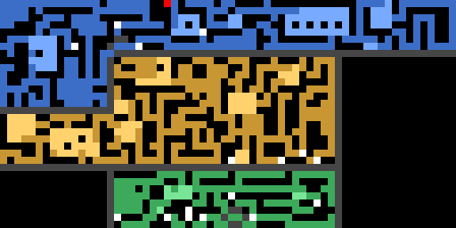
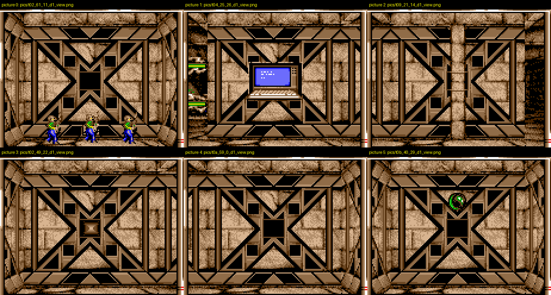
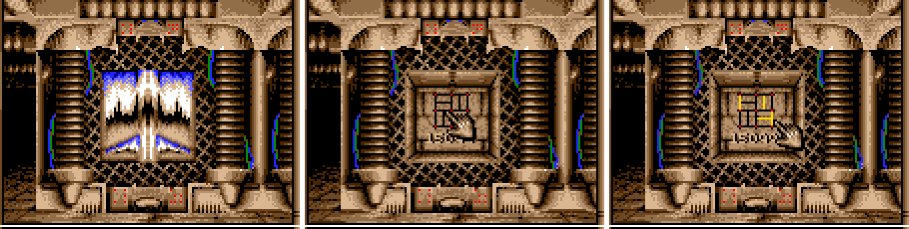
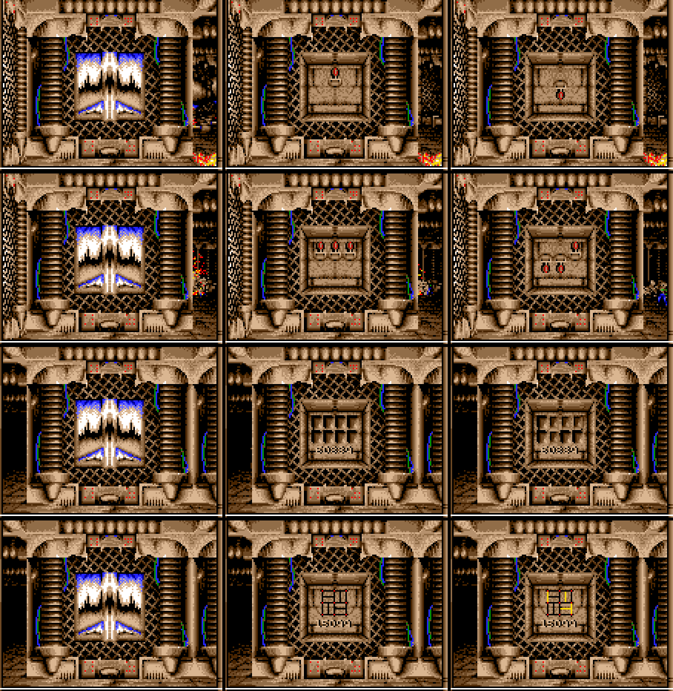
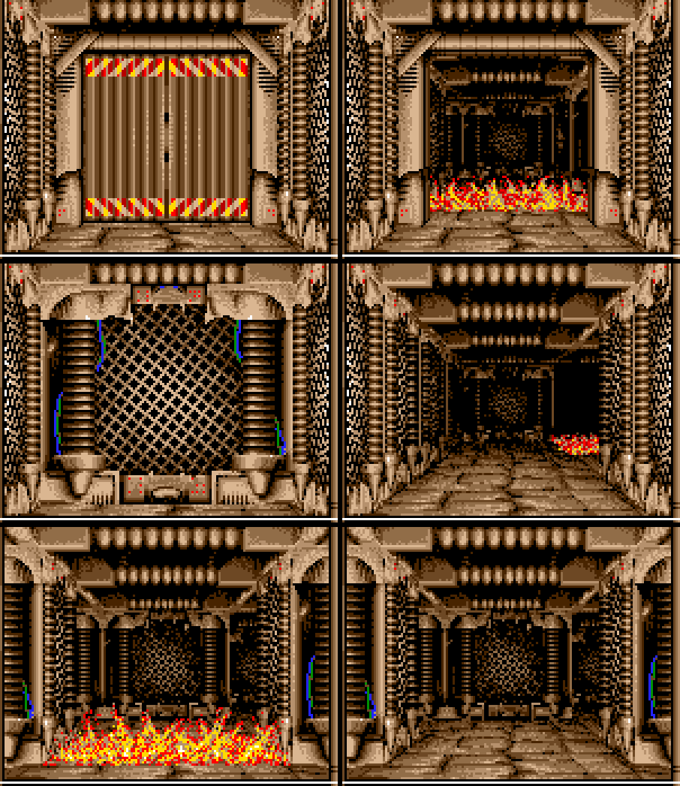
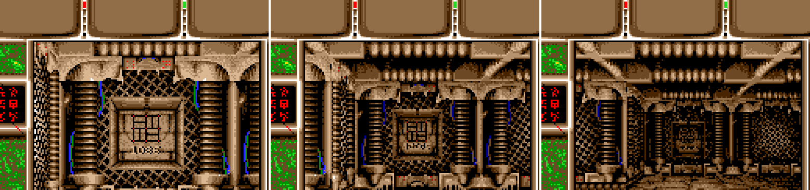
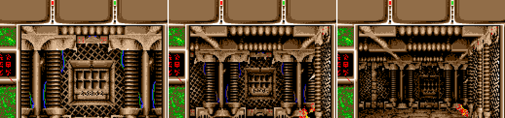

# The base generator, `fed_MapGen`

`fed_MapGen` builds every base Captive puts on a planet, and the planet surface around it, into one 64x32 grid.

**How it builds a base:**
- The grid is cut into 16 blocks of 16x8 cells. Each block is given to one of up to five floors.
- A random walk grows each floor over the blocks.
- Lifts join consecutive floors by a fixed translation.
- Shafts, chains of entries on two to five consecutive floors, are laid out before any corridor, and keep-out
  rectangles are reserved.
- A turtle "digger" then carves single-width corridors that never break into another passage. As it goes it drops
  rooms, looped caves and lifts, and opens a shaft's door when a corridor reaches it.
- Every carved cell keeps the number of the dig step that made it. The generator turns those numbers into a flow
  field: from any cell, following the arrows walks back to the entrance.
- Later stages prune dead ends (most of them in low-numbered bases, none from base 32 up) and paint rock rectangles.
  Then they place creature groups, locked doors whose keys lie on the entrance side of the door (except about one key in 250, which the
  generator drops on its own door cell, where the door seals it in), coded doors,
  traps, guarded dead ends, items, and the features the party meets: hand doors, valves, spinners, false walls,
  floor triggers and decorated walls.
- An encoder turns the grids into federation's tile layer and plane 2.

The whole base is a function of two arguments, the 16-bit base number D0 and the mode D2: the same pair gives the same
base. **Proven**: the whole generator, ported to Python and run from (D0, D2) alone, reproduces the emulator's
returned output in 400 of 400 bases (D2 = 0 and 1; D0 = 0..99 and the out-of-sample 300..399). The comparison covers
every byte the call leaves behind ("The pipeline").

Addresses are runtime addresses with the module loaded at `$1f7b0`, as on landing in
`scratchpad/captive/mg_entry.snap`. The module's variables are at A6 = `$20376`; federation's are at A6 = `$1b5ce`,
written `fed N(A6)` below. Proofs name a script in `py/mapgen/` (its README gives each command and expected output);
the rest is marked inferred.

`mapgen_base_d0_5.png` shows base 5 (D0 = 5): 12 blocks on 3 floors (`zones.py model 5`). The other examples are
`mapgen_base_d0_1.png` and `mapgen_base_d0_12.png`.
- Colour: floors 1, 2 and 3 are blue, green and orange, with rooms lighter.
- White cells are lift ends; the red cell on the top row is the entrance.
- Grey lines are block walls between floors; black is rock.

## Call interface and seeds

`federation` loads the module into the buffer at `fed 15770(A6)` and calls it at `$b5c2` with `jsr 32(A4)` (code
offset 0). The arguments come from `$b574`-`$b5c0`.

| register | value | meaning |
|---|---|---|
| A0 | `fed 9242(A6)` = `$1d9e8` | base of federation's output regions |
| A1 | `$b532` | table of 14 signed word offsets |
| D0 | `fed 32(A6)` | base seed |
| D1 | `fed 14790(A6)` | surface seed |
| D2 | mode | from `fed 13564(A6)` |
| D3 | `fed 14776(A6)` | |
| D4 | -1 | the init path; `$20054`: `tst.w D4; bpl` skips it |
| A2 | `$303c` | the depacker |

The A1 offsets are accumulated into 15 pointers at `13684`..`13740(A6)` (`$20092`-`$200e6`; "Output regions").

The mode is computed as follows:
- `fed 13564(A6)` = 2 gives D2 = 6.
- 0 gives D2 = 14 (landing; the mode becomes 2).
- 3 gives D2 = 0.
- Any other value gives D2 = 2.
- With `fed 14782(A6)` = 0 the mode becomes 3 and D2 = 1.

The module stores D0 at `12408(A6)` and as the RNG seed at `12404(A6)`, D2 at `12412(A6)`, D2 & ~1 at `13276(A6)`,
D1 at `13280(A6)` and D3 at `13278(A6)` (`$2006a`-`$2008a`).

`fed_MapView` sets the seeds (`$2f636`-`$2f65a`; driven for mission 1, target 1: D0 = 0, D1 = 0, `world.md`
"Targets and landing seeds"):
- D0 = `fed 14776(A6)` × 11 + the target index. The index is 10 for the special target at `$2f67c`.
- D1 = (`fed 14776(A6)` & `$1ff`) × 150 + the object index, or `$ffff` when there is none.
- `fed 14776(A6)` is stepped by `$8804`: inferred to be the mission number, so mission m's bases are D0 = 11(m - 1)
  to 11(m - 1) + 10.

**Branches on the mode.** Bit 1 of `13276(A6)` (`$23c78`) separates the base path `$23bb0` from the surface path at
`$23d58`:
- **Base (D2 = 0 or 1):** depends on D0 and D2 alone. Proven with `cmpcases.py`: D1 = `$1234` and D3 = 7 give a
  result byte-identical to D1 = 0 and D3 = 0, and two runs with the same arguments differ in 0 bytes; the chained port
  ("The pipeline") takes no other input. D2 = 1 adds the stage `$2676c` (`$23cde`), a 39-byte difference in the tile
  layer for D0 = 1.
- **Surface (D2 = 2, 6, 14):** re-seeds the RNG from D1 (`$23d58`). D2 = 2 is a target's compound, the walled area
  around the base entrance: in play (`py/ai/natural_base.repl`, D0 = 0, D1 = 0) it returns D0 = 48, D5 = the
  entrance cell (22,22) and D6 = the start (23,18) (`ai.md`, "Getting into a base"). D1 = `$ffff` builds the uniform
  landing surface: tile `$1e` everywhere, start (32, 16) in D6 (`$23d82`-`$23d86`). D1 = 164 and 165 differ in 406
  tile bytes; at D2 = 14, D3 = 1 and 2 give identical output (`cmpcases.py --all`). D3 is read only by `$23e36` and
  `$23e80`; the surface generator past `$23d94` is not read, apart from the compound builder's door ("Coded doors").

**Running it.**
- **Shortcut call.** `gen.py` calls `$20054` directly, from `mg_ret.snap`, with the caller's registers (labelled
  pokes). It skips the Copylock prologue at code offset 0, which is the only part that reads the disk.
- **Proof against the landing call.** For the landing arguments the shortcut rewrites every output region to the
  natural call's bytes: G0, G1, G2, both federation layers, the module variables and federation's tables
  `$1bd3e`-`$1d9e8`. The outputs are pre-filled with `$5a` first (`cmp_ret.py`: 8 of 8 regions equal).
- **Proof against a base-mode call.** For a natural base-mode call (`scratchpad/captive/agents/ai/req4_mg.snap`:
  D0 = 1, D1 = `$ffff`, D2 = 0, stopped at `$b5c2`, mode request poked), the shortcut's two layers equal the later
  `req4.snap`'s on 2048/2048 bytes each, ignoring bit 7 (which federation sets in play; `flowfield.py --snap`).
- **Cost.** A base costs about 2.6M to 4.7M instructions (D0 = 1, D2 = 1: 2,644,857; D0 = 5, D2 = 1: 3,830,954);
  the landing surface costs 234,362.

**Where the code lives.**
- The prologue runs Copylock-style trace decryption over `$1f84e`-`$2003e`. From `$20040` the module ships in clear:
  RAM at `mg_entry.snap` and `mg_ret.snap` is identical over `$1f7d0`-`$20376`.
- The module's own variables (`$35bc` bytes, cleared at `$20064`) overlay the file from `$20376` to `$23931`. The
  generator's code is `$20040`-`$20366` plus `$23936` to the end.
- The prologue supplies the argument registers through `$20376` (`$2004e`) and no seed.

## The pipeline

The base path `$23bb0` is a fixed list of calls; the encoder `$23936` and a copy of the block table follow at
`$200ee`-`$200f2`. Every stage has its own gate: a Python model starts from the emulator's state just before the
stage and must reproduce the state after it byte for byte (the whole module variable block, and federation's table
block `$1bd3e`-`$1d9e8` from `$25240` on). Every gate has a broken-model control that loses cases.

| # | stage | what it does | section | proof (script in `py/mapgen/`, count) |
|---|---|---|---|---|
| 1 | `$2624a` | the returned sheet mask | "The returned sheet mask" | chained gate |
| 2 | `$2011e`, `$201de`, `$20252`, `$202a2` | blocks and floors, lift offsets, entrance, block walls | "Floors and lifts" | `zones.py gate` 1000/1000 |
| 3 | `$245e2` | shaft layout | "Shafts and reservations" | `full/shafts/shafts.py gate` 1000/1000, 100/100 |
| 4 | `$263c2` | keep-out rectangles | "Shafts and reservations" | same, 1000/1000, 100/100 |
| 5 | `$244b6` | the digger | "The digger and rooms" | `digger/dig.py gate` 1000/1000, 100/100 |
| 6 | `$24d78` | clears the reservations | "Shafts and reservations" | `full/shafts/shafts.py chain` |
| 7 | `$24f4c` | the flow field | "The flow field (plane 2)" | `flowfield.py` 43,832/43,832 and 44,053/44,053 cells |
| 8 | `$25198`, `$2533a`, `$25198`, `$25162` | dead ends: list, prune, list, shuffle | "Dead ends" | `stages/gate.py` 80/80 each |
| 9 | `$263fa` | second room pass: paints rock rectangles | "Room pass 2" | `full/shafts/shafts.py gate` 1000/1000, 100/100 |
| 10 | `$25240` | a 3x3 patch of feature 9 | "Feature and item stages" | `stages/gate.py` 80/80 |
| 11 | `$2676c` | D2 = 1 only: the guarded farthest dead end | "Doors" | `full/cgate.py` 40/40 |
| 12 | `$25c1e` | features `$12`/`$13` on dead ends | "Feature and item stages" | `full/cgate.py` 80/80 |
| 13 | `$256f0` | room doorways | "Feature and item stages" | `stages/gate.py` 80/80 |
| 14 | `$25722` | locked doors, keys and prizes | "Locks and keys" | `full/cgate.py` 80/80 |
| 15 | `$25414` | trap plates | "Feature and item stages" | `full/cgate.py` 80/80 |
| 16 | `$2543a` | guarded dead ends | "Creature groups" | `full/pgate.py` 80/80 |
| 17 | `$2419a` | doors and kind-3 structures | "Doors" | `full/pgate.py` 80/80 |
| 18 | `$24d64` | G0 `$ffc3` to 0 | "Feature and item stages" | `stages/gate.py` 80/80 |
| 19 | `$24128` | hand doors | "Feature and item stages" | `stages/gate.py` 80/80 |
| 20 | `$240c2` | thin walls | "Feature and item stages" | `stages/gate.py` 80/80 |
| 21 | `$25d88` | the bulk of the creature groups | "Creature groups" | `full/pgate.py` 80/80 |
| 22 | `$26438` | floor triggers | "Feature and item stages" | `stages/gate.py` 80/80 |
| 23 | `$26478`, `$264ac`, `$264c8` | wall items `$19`, `$5f`, `$61` | "Feature and item stages" | `full/cgate.py` 80/80 each |
| 24 | `$265cc`, `$26606` | floor plates, valves | "Feature and item stages" | `stages/gate.py` 80/80 each |
| 25 | `$24d64` | G0 `$ffc4` to `$fff6` | "Feature and item stages" | `stages/gate.py` 80/80 |
| 26 | `$2630c` | decorated walls | "Feature and item stages" | `stages/gate.py` 80/80 |
| 27 | `$26854`, `$26532`, `$26570` | lift pairs, false walls, spinners | "Feature and item stages" | `stages/gate.py` 80/80 each |
| 28 | `$268f8` | D0 = 0 only: two items at (30, 1) | "Feature and item stages" | `full/cgate.py` 80/80 |
| 29 | `$23936` | the encoder | "Output encoding" | `full/chain_run.py encoder` 400/400 |

The stage gates' 80 cases are D0 = 0..39 at D2 = 1 and D2 = 0 (`$2676c`: the 40 at D2 = 1), from the emulator's
dumps at every stage boundary (`stages/dumpall.py`). The placement and late stages also pass 44/44 on D0 = 44..54 and
209..219, missions 5 and 20 (`full/pdump.py`; `$2676c` 22/22).

**The whole generator in Python** (`full/chain_run.py gate`).
- **Start state:** constructed, not captured. The module block is zeros plus the 15 output pointers (A0 = `$1d9e8`
  plus the accumulated `$b532` offsets, in `$20092`'s slot order) and five constants: `12400` = 1, `13208` = `$3f`,
  `13624` = `$c7`, `13628` = 7 (the coded-door slots), `13630` = 4. The seed-dependent bytes come from `zones.plan(D0)`,
  D0, D2 and the pillar threshold. Federation's block starts as zeros, `$ff` over the lists `13696`, `13700` and
  `13720`, and the empty headers of the object list and the group list. Both agree with the emulator: the module
  block with a capture at `$23ca4`, federation's block with `mg_ret.snap`.
- **Chain:** every stage model in table order, the encoder, and `$200f2`'s copy of module bytes 0..33.
- **Comparison:** the whole module block, federation `$1bd3e`-`$1ea08` (every list, both layers and the untouched
  32 bytes between them), and the returned D0, D5 and D6.
- **Result:** 400/400. The cases are D2 = 0 and 1 with D0 = 0..99 and the out-of-sample D0 = 300..399, captured at the
  call's return with `full/capture_final.py`. Control: a key accepted up to `$4000` dig steps after its door
  (`--break key_slack=0x4000`) gives 14/200 on D2 = 1, D0 = 0..99 and D2 = 0, D0 = 0..99.
- **Limits:** the models still read their constant tables (the creature types, lock kinds, tile list and the
  direction tables) from the module and federation code in `mg_ret.snap`'s RAM. The surface path is not ported.

## Floors and lifts

**Random numbers.**
- `$23b96`: x = (x × `$5e5` + `$29`) mod 2^16 in `12404(A6)`, returning ror16(x, 4) xor `$800`. In the base path it
  is seeded with D0.
- A second stream `$245ce` with the same LCG at `13656(A6)` returns ror16(x, 3). The digger clears it at its start
  (`$244ba`); it drives the restart lift attempts and the creature groups' sizes and stats.

**Blocks (`$2011e`).** Module bytes `0..15` hold one floor number per 16x8 block, row-major over a 4x4 grid.
- **Base size.** The mask table `$20110` (`cc00 f600 ff00 ff60 fff0 fff6 ffff`), indexed by min(D0, 6), gives the
  blocks in the base: 4, 6, 8, 10, 12, 14 or 16, bit 15 first. The others get 6, meaning outside.
- **Floor count.** 2 + (r & 3) floors, or 1 when D0 = 0.
- **Floor growth.** Each floor starts on a random empty block (`$20328`). It walks one block at a time in a random
  direction (`$2033e`, steps at `$20366`/`$2036e`), claiming empty blocks and passing over its own. It stops when it
  leaves the grid or meets another floor.
- **Leftovers.** When the walks leave blocks empty, each copies a random in-grid non-empty neighbour, possibly 6
  (`$2019a`-`$201da`). Base 5's mask marks 14 blocks; two became 6, leaving 12 on 3 floors.
- The floor count actually placed is stored at `46(A6)`. The count drawn is at `12418(A6)` and the placed one again at
  `13274(A6)`; both are written during `$2011e` (the chained gate's input check), but the writing instruction has not
  been found.

**Lift offsets (`$201de`).** For each floor k below the last, one random block of floor k and one of floor k+1 are
chosen. Their block difference × (16, 8) is stored as words at `16(A6)` + 2(k-1) (x) and `24(A6)` + 2(k-1) (y). The
lift routines add these offsets going up (`$2514c`) and subtract them going down (`$25136`). A lift therefore keeps
its position within its block, and the two ends of a shaft lie in different blocks of the one grid.

**Entrance (`$20252`).** A random column 0..63 with (col & 15) ≠ 15, on row 0, stored at `32(A6)`; its block's floor
is at `34(A6)`. D0 = 0 replaces the table with a single column of floor-1 blocks (1, 5, 9) and the column with 30.

**Block walls (`$202a2`).** G0 gets `$ffff` along a block's right column and bottom row where the neighbouring block
is on a different floor, and 0 elsewhere.

**Proofs.**
- `zones.py` is a Python transcription of all of the above. `zones.py gate 0 1000` matches the emulator on module
  bytes 0..55, the RNG word and all 4096 bytes of G0 at `$202a2`'s return, for 1000 of 1000 seeds.
- Every lift end has its partner on the adjacent floor at exactly that pair's offset: `liftpair.py 0 41`, 510 of 510
  lift cells over D0 = 0..40. Lift-end features are 4 (up), 5 (down), 6 (both), and `$35`-`$37` on room floor.
- That floors are separate levels is inferred: federation's automap (`$10ff4`) draws only the cells whose block's
  floor, from its copy of the table at `fed 9206(A6)`, equals the current floor `fed 15688(A6)` & 7. The words
  "floor" and "lift" are this doc's; the game's strings do not name them.
- Module bytes 0..33 are copied to `fed 9206(A6)` at `$200f2`. The caller reads the entrance column from
  `fed 9238(A6)` into the position at `$b5d6`.

## Shafts and reservations

Two stages run between the floor plan and the digger. Each saves the main RNG word and restores it afterwards
(`$23ca0`/`$23ca8`, `$263da`/`$263f4`), so neither changes the digger's random stream.

**Proven** (`full/shafts/shafts.py gate`): the port of `$245e2` matches the whole module block at `$23ca8` and the 50
bytes at `13712(A6)` for 1000/1000 bases (D2 = 1, D0 = 0..999) and 100/100 (D2 = 0, D0 = 0..99); the port of `$263c2`
matches the block at `$23cb0` on the same cases. Controls: entries laid in the wrong direction (`--break dir`) give
2/1000 (only the bases with no shafts); no door cell (`--break nodoor`) gives 7/1000; no reservations (`--break nores`)
499/1000, the bases that have none.

**Shaft layout (`$245e2` through `$24606`, `$2465e`, `$24754`, `$24718`).**
- **Groups:** min(D0/2 - 1, 4) + 1 groups, none for D0 ≤ 1.
- **Start:** random cells (`$244a2`, main RNG) until one is rock on a base floor (`$2482e`: floor ≤ `46(A6)`, G0 = 0).
- **Dry run (`$2465e`):** try an entry there (`$24754` with `13574(A6)` = 0, nothing written), move up a floor
  through the lift offset (`$2514c`), and continue while the cell lies in a block of the next floor (`$249c4`) and is
  rock. The result is a chain of at most 6 entries (in practice 5) on consecutive floors, each at the same position
  within its block.
- **Accept:** two or more entries are placed (`13574` = `$ff`) and listed. Exactly one is rejected and the start is
  redrawn. None is accepted as an empty group, which still uses its slot.
- **An entry** is three cells in a row pointing towards the block's centre (east when x & 15 ≤ 7, else west;
  `13578(A6)`): a `$1c` cell with G0 2, a `$18` cell with G0 1, and the door, feature `$0f` with G0 `$ffff`. `$24718`
  writes `$ffff` walls behind the `$1c` cell and above and below both the `$1c` and `$18` cells; every wall cell must
  be rock or wall, with G1 = 0 and y ≠ 0. The door is the unwalled end, facing into the block.
- **Lists:** doors at `13360(A6)`, `$1c` cells at `13410(A6)`, `$18` cells at `13460(A6)`; each is 5 groups of 5
  (x, y) pairs, `$ffff` for unused. The `$18` list is copied to federation at `13712(A6)` = `$1bf08`, where `$2419a`
  later puts plain doors.
- **Example:** seed 2 has entries at (18,4), (50,4) and (34,12), with lift offsets (+32, 0) and (-16, +8).
- **Census** (`full/shafts/shafts.py stats`, 1000 bases, D2 = 1): 990 bases ask for 5 groups. Of the 4,970 groups,
  1,608 are empty; the rest have 2 entries (2,490), 3 (610), 4 (197) or 5 (65). Groups start on floors 1 to top - 1.
  The door lies 2 cells east of its `$1c` cell in 4,109 entries and 2 cells west in 3,814. Why so many groups come
  out empty has not been measured.

**Room reservations (`$263c2`).** Temporary keep-out rectangles that the digger cannot enter.
- **How many:** one for D0 = 0; `$2640a`(~D0) + 1 for D0 with bit 1 set; none otherwise.
- **Each:** at a random cell, built by the room builder `$249da` in mode `13584(A6)` = 1, with the raw LCG state
  `12404(A6)` (not the RNG's output) as its size word. Every cell needs 4 uncarved neighbours and must not be on
  row 0. The cells get G0 `$fffd` and nothing else: no feature, pillars, room-list entry or shaft trigger. The heading
  `12424(A6)` is 0 at that point in every case, so the rectangles grow north.
- **Clear:** after the digger, `$24d78` (`moveq #-3,D5; clr.w D6; bra $24d64`) turns `$fffd` back to rock.
- **Census** (same 1000 bases): rooms tried per base 0 (499 bases), 1, 2, 4, 13, 26, 52, 53, 104 or 105; 12,988 of
  35,665 placed; 157,914 `$fffd` cells at the digger's start.

**Chain to the second room pass** (`full/shafts/shafts.py chain`). From (D0, D2) alone, the floor plan, shafts,
reservations, digger, clear, flow field, the dead-end stages and `$263fa` reproduce the whole module block at the
digger's return `$23cb4` and at `$263fa`'s return `$23cd0`: 1000/1000 at both (D2 = 1) and 100/100 (D2 = 0); the
state built at `$23ca4` equals the emulator's in every case. No reservations (`--break nores`) gives 129/250 at
`$23cb4` (D0 = 0..249).

## The digger and rooms

`$244b6` (from `$23cb0`) does most of the work: 1,708,805 of the 2,644,857 steps for D0 = 1, D2 = 1 (`stages.py`).
It writes 891 of the G0 bytes, and no other stage moves more than 64 (`stagedump.py`).

**Proof.** `py/mapgen/digger/dig.py` is a register-level port of `$244b6` and every routine it calls. Its output
equals the emulator's over the whole module variable block: G0, G1, G2, the room list, both RNG words `12404` and
`13656(A6)`, every other variable, and D1-D7 at the return. The port starts from the emulator's state at `$23cb0`.
- **Gate:** 1000/1000 for D2 = 1, D0 = 0..999, and 100/100 for D2 = 0, D0 = 0..99 (`digger/README.md`).
- **Controls** on the same 1000 seeds:
  - a carve rule that needs 2 uncarved neighbours instead of 3: 0/1000;
  - rooms one cell narrower: 0/1000;
  - no pillars: 24/1000.

The rules below are what the gated port computes. Readings that the gate does not separate are marked inferred.

**The turtle.**
- **State:**
  - a position (D1, D2);
  - a floor D3, starting on the entrance's floor (`$244be`-`$244c4`);
  - a heading at `12424(A6)`: 0, 2, 4, 6 for N, E, S, W (dx, dy tables at `$248c4`/`$248cc`), starting east;
  - a counter D4 that starts at 1.
- **Carving:** `$24f3c` writes D4 into G0 and increments it. The entrance is carved twice (`$244e6`, `$244f0`), so it
  holds 2. The shafts' `$18` cells hold 1 and their `$1c` cells 2, written by `$24754` before the dig.
- **Uncarved:** a cell counts as uncarved (`$24efc`) when it is rock, outside the grid, or has G0 above `$ffce`.
  That covers block walls, closed shaft doors (`$ffff`), the blob fence (`$fffe`) and the reservations (`$fffd`). The
  tested cell itself must be rock, or its count is 0.
- **Carve rule:** a corridor cell is dug only when exactly 3 of its 4 neighbours are uncarved (`$24e8c`,
  `cmp.w #3,D6` at `$24514`). It touches nothing but the cell it is dug from, so a single corridor carve never merges
  two passages: the perfect-maze condition. The whole base still has loops (below).

**Each step (`$24872`)** draws a random word into `12426(A6)`. Its low 3 bits are a selector:
- 0 or 1: turn left or right, then move one cell forward in the same step;
- 2 or 3, when the word is above `$ccb0` and D4 > 4: a lift up (2) or down (3) (`$248f0`/`$24902`). The far end must
  lie in a block of the destination floor, at the floor pair's offset, with 4 uncarved neighbours. After a lift the
  turtle stands on the far end and draws a new word without carving (D5 = -1, `$249c0`). Every in-bounds lift attempt
  adds 1 to the restart counter `12414` and takes 1 from the lift budget `12416`, whether or not it succeeds
  (`$2491e`/`$24922`);
- otherwise (4..7, or 2 and 3 with a lower word) the word's size decides: a blob (`$24c5c`, word ≤ `$7ad`), a room
  (`$249da`, word ≤ `$8f48`), or one step forward.

**Failure and restarts.**
- **Retries:** when a carve fails, the turtle restores its position (`$24d88`) and retries up to 10 times. Each retry
  re-draws only a 2-bit selector, D0 = rng & 3 (`$2451e`), and keeps the step word. A turn retries in a new
  direction and a lift word retries the lift; a retried room or blob word repeats the same check from the same cell
  and heading. Over the 1000 gated D2 = 1 bases, 626,856 retried room calls carved no room; all 25,771 rooms came from
  a room word's first try (measured with the gated port, `py/infographics/digger.facts.md`).
- **Restart:** after 10 failures it tries up to 100 random cells (`$2452a`).
  - If the second RNG (`13656`) is above `$a200` and the cell is carved with feature `$1f $35 $36 4 5 $33 $11` (room
    floor, lift ends, blob floor), the restart is a lift attempt from that cell (`$2458a`-`$245a4`). It sets D0 = 2
    (3 when bit 4 of `12427(A6)` is set), forces the step word above `$ccb0`, takes one from the restart counter and
    runs the step. If the lift fails it steps forward instead.
  - Otherwise, and also when the drawn cell has none of those features, the restart takes any uncarved cell that
    touches exactly one carved cell.
- **End:** the restart counter `12414(A6)` starts at 300; every restart takes 1 from it and every in-bounds lift
  attempt gives 1 back, so a dig makes more than 300 restarts (base 5: 578). The lift budget `12416(A6)` starts at
  900. D4 ≤ `$3000` is also tested but never ends a dig. Over the gated runs, D2 = 1 ended on the restart counter in
  874 of 1000 and on the lift budget in 126; D2 = 0 in 89 and 11 of 100.

**Rooms (`$249da`).** The room builder serves three passes through the mode word `13584(A6)`: 0 for the digger's
rooms (here), 1 for the reservations and 2 for the second room pass.
- **Size:** let s = (r ror 6) & `$3f`, masked with `$1b` when r > `$3ff7`, where r is the step word. The room is
  ((s & 7) + 2) × (((s >> 3) & 7) + 2) cells. The check loops at `$24a88`-`$24ae2` are `dbf` loops on the stored
  w - 1 and h - 1, so each runs once more than the stored count. **Proven** over 25,771 rooms in the 1000 gated bases:
  every bounding box has that size (`digger/rooms.py`).
- **Check, then carve:** the room's first cell (the one ahead of the turtle) needs 3 uncarved neighbours and every
  other cell 4, so a room touches the maze only at its entry. A failed check makes the step a plain forward move
  (`$24bde`-`$24bea`).
- **Pillars:** a room wider and taller than one cell takes a pillar pattern from the bit table at `$24c1c` (row
  offset r & `$38`). Pillar cells stay rock, with feature `13652(A6)`: 0, or `$20` when r rol 2 exceeds
  `$eeff` - 8·min(D0, `$7f7`) (`$23bc6`, `$24a06`-`$24a18`). 20,578 of the 25,771 rooms have none. A 9-row room reads
  its ninth pattern byte past the table, from the code at `$24c5c` (`$61`). That is harmless because the last row
  never takes pillars, but the port has to copy it.
- **Numbering:** room cells are not dig order. Row r starts at D4 + 8r, each cell adds 2 and each pillar 8. After the
  room, D4 grows by 8(h + 1) + `$48`.
- **Floor feature:** `$1f`, or `$33` for some rooms when D0 > 4 (`$24a22`-`$24a3e`).
- **Room list:** up to 63 rooms at `12952(A6)`, counting down from `13208(A6)`. Each entry is (x, y, floor, s), where
  (x, y) is the room's last carved cell and s its size byte (`12436(A6)`). **Proven** (`rooms.py`): 25,588 of 25,771
  entries match, and the other 183 are cells that later became lift ends; none is unexplained.

**Blobs (`$24c5c`).**
- **Fence:** `$24d2c` marks with `$fffe` every rock cell next to a carved cell, and the turtle's own cell.
- **Walk:** the blob carves the cell ahead with feature `$11` (`$14` when rol(r, 8) ≤ `$2710` and D0 ≠ 0), then walks
  50 random steps (`$24cd4`). It carves rock, walks over carved cells, and turns back at `$fffd`-`$ffff` or the grid
  edge.
- **Clear:** `$24d60` clears the fence afterwards.
- **Result:** a looped cave joined to the maze only through its first cell.
- **Side effect:** the blob's step `$2484e` overwrites the saved position `48`-`52(A6)`, so the next restore
  (`$2451a`) lands on the blob's last cell, not the turtle's.

**Opening shafts** (`$24d96`/`$24dda`, after every room, lift and blob cell). When a shaft door has exactly 2
uncarved neighbours, that is, a passage has reached it:
- that floor's door, `$18` and `$1c` cells are carved, and the `$1c` becomes `$1d`;
- every other floor's door in the group that touches exactly one carved cell is carved too;
- the turtle moves to the last door opened (`13286`/`13288(A6)`, `$24dc2`-`$24dd0`) and digs on from there.
- Over the 1000 D2 = 1 bases, 3,309 of the 3,362 non-empty groups have exactly one entry opened (`$1d`) after the
  digger; 53 were never reached (`full/shafts/shafts.py stats`).

**Loops** (`digger/dig.py tree`, over the 1000 gated bases). A cell counts as carved when 0 < G0 < `$ff00`. Edges join
orthogonally adjacent carved cells on one floor. A base is a forest when E - V + C = 0.
- **Raw cells:** 0 of 1000 are forests, because rooms and blobs are open areas.
- **Rooms and blobs contracted to one node each:** 819 of 1000 are forests. The 232 cycle-closing edges in the other
  181 all touch a shaft:
  - 228 between a blob and a shaft cell;
  - 3 between a corridor and a shaft cell;
  - 1 corridor-to-corridor edge (seed 958), dug beside a door while it was closed.
- **With lifts and shafts as edges:** every base is one connected component, and 503 of 1000 are forests (925
  cycles), because shafts and lifts give alternative routes between floors.

So the corridors are a perfect maze per floor, and the loops in a base come from its blobs and its shafts.

## The flow field (plane 2)

`$24f4c` runs after the digger and the reservation clear. For each cell whose G0 is neither 0 nor `$ffff`:
1. It looks for a better candidate, starting from a best of `$4000`:
   - first the lift partner on the floor above (value 4, features `$1c $37 $06 $1a $35 $04`);
   - then the lift partner on the floor below (value 5, features `$1c $37 $06 $1b $36 $05`);
   - then, unless the feature is `$1c`, `$1a` or `$1b`, the neighbours N (0), S (2), E (3) and W (1), in that order.
   A candidate counts when it is open and its G0 ≤ the best so far (`$250f6`); it then becomes the best and its value
   is kept.
2. The value goes into G2 byte 0.
3. A cell with no feature gets feature 7.
4. The entrance's G2 word is cleared and its G1 parameter set to `$7e` (`$25010`-`$2501a`). The shaft cells listed at
   `13410(A6)` get 4, or 5 after a feature-`$1d` cell in their group (`$2503c`), with their full G1 word.

Each arrow therefore points to the open neighbour or lift partner with the lowest carve number. Because room cells are
numbered in rows with gaps and blobs walk over their own cells, the arrows descend the carve numbers rather than
retrace the dig step by step. Following them still leads from every open cell to the entrance, riding a lift where the
dig did: 915 of 915 open cells in base 5, with 3 of all the steps summed over those walks going to a higher number
(inferred to be lift or shaft steps; `py/infographics/digger.facts.md`). One exception is known: D0 = 352 has a
2-cycle of arrows inside a room at (3,15)/(4,15) ("Locks and keys").

**Proof.** `flowfield.py` transcribes this and matches the emulator on every open cell:
- 43,832 of 43,832 cells for D0 = 1..40 with D2 = 0;
- 44,053 of 44,053 for D0 = 0..40 with D2 = 1;
- no later stage changes G2.

**Consequence.** The 4 and 5 cells are "take the lift" steps on the way back, not destinations.

**Use in play (inferred).** Federation exports this field as plane 2 (below), and creatures follow it
(`reversing/captive/ai.md`).

## After the flow field

Every later stage works on the finished maze. Unless a line says otherwise, the rules are what the gated models
compute ("The pipeline"): `stages/models.py` for 17 calls, `full/cmodels.py` and `full/pmodels.py` for 11, and
`full/shafts/shafts.py` for `$263fa`. The README in `stages/` lists the controls for its 17 calls; for example,
`--stage 2533a --break 'prune_keep=(3,)'` gives 16/80 and `--stage 2630c --break pic_mod=5` gives 0/80. Every random
draw goes through the RNG `$23b96` unless it names `$245ce`. A "random cell" is `$244a2`: x = r & `$3f`,
y = (r ror 6) & `$1f`. A "plain cell" is an open corridor cell with feature 7 (`$2664e`).

### Dead ends

- `$25198` lists the dead ends: open cells with exactly 3 blocked neighbours, scanned y = 31..0, x = 63..0.
  - It skips the entrance and the lift and special features `$06 $37 $1c $1d $1a $1b $05 $04 $36 $35 $0f $21 $18`.
  - It keeps at most 254, as (x, y) byte pairs at `12440(A6)` (count at `12438`), and gives each listed cell
    feature `$7f`.
- `$2533a` prunes them against a threshold T = D0 × 2048 for D0 ≤ 31, else `$ffff`. Bases 32 and up are therefore
  never pruned.
  - For each listed cell it draws r. When r > T it takes one step along the cell's plane-2 arrow.
  - If the cell it reaches does not have 2 or 3 blocked neighbours (it is a junction), the dead end is filled back
    to rock (G0 = G1 = 0).
  - So low-numbered bases lose most of their one-cell stubs. That later bases are meant to be harder mazes is
    inferred from this rule, not measured.
- `$25198` then runs again to rebuild the list.
- `$25162` shuffles the 256 slots with 513 random swaps, then restores the RNG seed.
- Most later stages draw their sites from this list with `$2567e` (a random slot, then the next filled one), and
  several clear the slot they use.

### Room pass 2

`$263fa` digs no corridors. It paints rock rectangles that touch the finished maze.
- `$2640a`(D0) + 1 rooms, each at a random cell with the raw LCG state as its size word, through the room builder in
  mode 2.
- **Check** (`$24aa6`-`$24ab6`, `$24ae6`-`$24af2`): every cell in the grid and not above `$ffce` (so no wall, door or
  reserved cell), and at least one cell already carved (`13654(A6)` > 0).
- **Paint** (`$24b28`-`$24b38`): only cells with G1 word 0 get feature `$23` and G0 `$ffc4`. The second `$24d64`
  later turns `$ffc4` into `$fff6`, and the encoder maps `$23` to tile `$26`.
- **Proven** (`full/shafts/shafts.py gate`): the block at `$23cd0` matches 1000/1000 and 100/100. Controls: rooms of
  the wrong size (`--break roomsize`) 11/1000; no overlap test (`--break nooverlap`) 770/1000.
- **Census** (`full/shafts/shafts.py stats`, 1000 bases): 17,312 of 30,360 rooms changed the grid, painting 100,625
  cells, 27,869 of them on cells reserved before the digger.
- Inferred: the reservations keep the maze out of rectangles that this pass later fills. Tile `$26` draws as a wall
  of flames, the same tile as door kind 2 ("Locks and keys"); that these painted rectangles are flame fields in play
  is inferred from the shared tile, not driven from a painted cell. `$25d88` puts creature groups on these cells.

### Creature groups

**The group writer `$25e10`** (entered at `$25e08` with a start index) adds one group to the list at
`fed 4532(A6)` = `$1c782` (header at `13716(A6)` = `$1c77e`: total `$1000`, free; the list ends with `$88828881`).
`ai.md` reads the list in play.
- **Type:** chosen round-robin, not at random. A cursor walks the 64-entry type table `$26040` (8 bytes each)
  cyclically from the last type used: class-0 calls use `13744(A6)`, classes `$40` and `$80` share `13746(A6)`.
  `$25e08` stores its caller's start index into `13746` and forces class `$80`. A type is taken when its class nibble
  (byte 0 bits 4-7) equals the call's class, its maximum-member nibble is non-zero, its minimum base number (word 6
  bits 0-4) ≤ D0, and its sheet field n (word 6 bits 5-7) is 0 or bit n-1 of the returned sheet mask is set
  (`$25e30`-`$25e8c`).
- **Random draws:** one word of the second RNG `$245ce` per group. Members = min(type max, ((r ror 4) & `$1f`) + 1)
  (`$25fda`); timer +6 = r & `$f`; period +7 = (timer >> 1) + type byte 4. Per member, after further rotations of r:
  byte +4 = type byte 1 + (r & 3), capped at `$fd`; skill +5 = type byte 5 + (r & 3).
- **Hit points** (member word +2, `$25f26`-`$25f8a`): P = type word 2 × F with F = 3·min(D0 + 1, 127) - 2 + `54(A6)`,
  then P + ((P & `$ffff`) × r >> 16) + (r × (D0 >> 1, or >> 2 when D0 > 16) >> 16), capped at `$ffdc`. `54(A6)` is 2
  for guards (`$254d4`) and 0 otherwise.
- **Flags +5:** `13664(A6)`, where callers set or clear bit 4 (hostile); bit 6 (relentless) comes from type word 6
  bit 8.
- **Carry +4:** when `13666(A6)` is set, or while the counter `13274(A6)` is non-zero, the 4-byte item at `13668(A6)` is
  stored in the carried-item list `13728(A6)` = `$1c73e` (16 × 4, index `13650`) and +4 = `$80` | index. The `13274`
  path counts down and carries item `$62` (MAP); `13274` starts at the floor count. The bit-7 effect in play is in
  `ai.md`.
- **Full:** the write fails (D0 = -1) when (members + 1) × 8 exceeds the free count.
- **Records:** group +0 x, +1 y, +2 size, +4 carry, +5 flags, +6 timer, +7 period; member +0 type, +1 slot (from the
  slot lists at `$2602a`), +2 hp, +4 byte (meaning unread), +5 skill.
- **Types** (`full/typetab.py`): 42 of 64 defined. Class 0 is plain, class `$40` goes on room-pass-2 cells, class `$80`
  marks structures, carriers and the D2 = 1 guard. Relentless types: 3, 20, 26, 31, 36, 37. Sheet 5 and 6 types (37-41)
  need mask bits 4 and 5, which only the surface sets.

**Proven** (`full/pgate.py`, `$25d88`, `$2543a` and `$2419a`: 80/80 and 44/44). Controls: `--stage 25d88 --break
skill_add=1` 0/80; `--break hp_cap=0x8000` 51/80; `--stage 2543a --break guard_hpadd=0` 0/80.

**Who places groups.** Over D2 = 0, mission 1 (D0 = 0..10), 1,063 groups: `$25d88` 656, `$25722` 181, `$2543a`
164, `$2419a` 44, `$25c1e` 18 (`full/groups.py`). D2 = 1 adds 11 from `$2676c`.
- `$25d88` runs late: 300 random cells. A cell with G0 above `$a` and feature `$07 $0f $0c $1f $33 $09 $11 $14` gets a
  class-0 group, one with feature `$23` a class-`$40` group; the feature gets bit 7. It stops at the first failed
  write, so it fills whatever space is left. From about D0 = 4 up the 4,088-byte list ends 0 to 72 bytes short of
  full (`full/perbase.py`): the group count is set by the list size and the member-count draws.
- `$2543a` guards dead ends: up to 101 dead-end picks, stopping at 32 guards (`13266` > `$1f`) or when the list is
  empty. The arrow chain from the dead end must reach P1 with exactly 2 blocked neighbours and then P2 with at least
  one, both plain. A rock cell beside P2 (`$25632`, tried N, S, W, E) becomes a wall object: feature `$22`, parameter
  2 × side, G0 `$ffc3`, with an item from `$26722` of type min(hi(r × (min(D0, 22) + 1)) + `$36`, `$4c`). The dead end
  gets a hostile class-0 group with the +2 hit-point factor; P1's G1 word is cleared; (wall, P1) goes to the guard
  list `13732(A6)` = `$1d8c2` (count `13266`). The wall object's meaning in play is inferred.

**Difficulty per mission** (`full/groups.py`, the emulator's final group lists; D0 = 11(m - 1) + target, target
0..10, the mission mapping inferred in "Call interface and seeds"):

| D2 | mission (D0) | groups per base, mean (range) | members per group | period median | hit points median (max) | skill median | hostile | relentless |
|---|---|---|---|---|---|---|---|---|
| 0 | 1 (0..10) | 96.6 (24..146) | 3.59 | 12 | 678 (17,750) | 40 | 164/1063 | 57 |
| 0 | 5 (44..54) | 120.1 (101..151) | 3.23 | 10 | 8,994.5 (65,500) | 51 | 136/1321 | 97 |
| 0 | 20 (209..219) | 116.5 (97..143) | 3.37 | 10 | 23,023 (65,500) | 51 | 130/1282 | 131 |
| 1 | 1 (0..10) | 117.7 (24..173) | 1.96 | 7 | 2,228.5 (12,618) | 201 | 166/1295 | 29 |
| 1 | 5 (44..54) | 161.0 (132..177) | 2.11 | 7 | 14,724 (64,951) | 201 | 150/1771 | 79 |
| 1 | 20 (209..219) | 152.2 (138..167) | 2.28 | 7 | 35,236 (65,500) | 201 | 135/1674 | 123 |

- Hit points grow linearly with the base number up to D0 = 126 and then flatten, reaching the `$ffdc` cap (65,500)
  in missions 5 and 20 (from the formula; the table measures it).
- Period and skill come from the type entry plus 0..15 or 0..3 at random, so their change across missions is the
  type mix; the minimum base numbers 0..10 unlock every type by D0 = 10 (inferred from the table `$26040`).
- Hostile groups are exactly the `$2543a` guards plus `$2676c`'s groups (D2 = 0, mission 1: 164 = 164; D2 = 1: 155 +
  11 = 166).
- Relentless groups grow as the relentless types with high minimum base numbers (20, 26, 3) appear more often.
- D2 = 1 bases use only types 6, 8, 29, 30, 31, 35 and 36 (sheet mask 8).

### Doors

**`$2419a`, doors** (`full/pgate.py` 80/80, 44/44; controls `--stage 2419a --break struct_walk=4` 3/80,
`--break struct_start=6` 5/80).
- **Pass 1:** a plain door on each of the 25 cells of `13712(A6)` (the shafts' `$18` cells), parameter 1 when the
  east neighbour's feature is `$1a`-`$1d`, else 9.
- **Pass 2:** 300 random starts at (rng ror 1), each walking up to 17 arrow steps. `$24230` reads the cell's 5-bit
  blocked mask; a blocked centre ends the walk. A cell walled east and west (`$a`) or north and south (`$11`, kind +8)
  is a candidate. It is skipped when its feature is not 7, and the start ends when the feature is below 7 or at least
  `$87`, or a door is beside it. Any other mask below `$11` also ends the walk, through the N flag of
  `cmp.w #$11,D6`; masks above it step on (proven by the gate).
- **Kind:** from the byte table `$24228` (`00 02 03 05 00 07 03 05`); D0 = 0 makes every door plain. The shared door
  placer `$24298` dispatches on the kind's low 3 bits: 2 is a coded door while the slot counter `13628(A6)` is
  non-zero, 4 a coded door with no counter check, 3 a structure, anything else a plain door (feature `$15`, counted
  in `13618(A6)`).
- **Kind 3, structures** (`$24306`, at most 8; 0 to 8 seen): the door gets feature `$15`. A rock cell beside the next
  one or two arrow cells gets G0 `$ffc3` and a decorated face (feature `$2c`, side mask from `$24490` = `04 02 01 08`)
  recorded through `$26398` in the wall-picture list with picture 1 and n = the structure number `13638(A6)`. After
  (r & `$f`) + 4 more open arrow steps, a class-`$80` group (types 6, 8 or 31) carrying item `$65` | n (a CLIPBOARD) is
  placed, whatever the writer returns. The door's successor gets feature `$0f`, and (wall, door) goes to `13740(A6)` =
  `$1d942` (count `13638`, at most 8; 5 of 124 bases have 8). Picture 1 draws a wall terminal ("Feature and item
  stages"). Inferred: each structure is a terminal ("SECURITY LOCK / ENTER CODE / DATA LOCK" at `$131cd`-`$13209`)
  paired with a numbered clipboard.

**`$2676c`, the guarded farthest dead end** (D2 = 1 only; `full/cgate.py` 40/40, control `--break vault_kind=5`
0/40). It takes the listed dead end farthest from the entrance by arrow steps (ties go to the later slot) whose
arrow successor is walled on both sides. The successor gets a kind-4 coded door, with its code from the base RNG. The
dead end gets a hostile class-`$80` group (start index 30) and G0 `$ffea`.

### Coded doors

The combination lock's door list (`ai.md`, "Getting into a base", where the lock, its corner orders and the DIE
item's hints are described) is written by the generator.
- **Proven** (`stages/doorwatch.py natural scratchpad/captive/base1/land_mg.snap 3000000`, no pokes): in the natural
  compound call for mission 1, the 8-entry list at `fed 2330(A6)` = `$1bee8` (pointer `13708(A6)`) is first cleared
  by `$23b8e`. It then gets exactly three writes: x = `$16` at `$242f0`, y = `$15` at `$242f2`, and state `$0080` at
  `$24300`. The list ends as `1615 0080`, the entry `base1/outside.snap` holds, and federation does not write it
  afterwards. The shortcut call `doorwatch.py shortcut 0,0,2,0` gives the same writes. The stack at `$242f0` returns
  to `$23dae`, inside the compound builder `$23e80`.
- **The door placer `$24298`** writes a coded door (kinds 2 and 4) to slot 7 - `13628`. The counter starts at 7
  (`$23c66`) and counts down, so the slots fill from 0. The door's code is the high word of (RNG word `12404(A6)` ×
  24), stored as state = code << 4. The code indexes the 24 corner orders at `$e358`. For the mission 1 compound,
  `$59c6` × 24 = `$86d10` gives code 8, the code `ai.md` found by play. In base mode this is proven by the chained
  gate (the list is part of the compared block).
- **Inferred from the code** (the surface path is not ported): `$23e80` walls the compound with turtle moves
  (`$23fde`/`$23fa2`; walls are G0 `$ffff`, feature `$80`) and sites it at (22,20) for D0 = 0 when bits 2 and 3 of
  `13277(A6)` are clear, otherwise at a random open cell in [3..60] × [3..28]. It ends in `bra $24298` with kind 4.
- **Proven, structurally**, over the 80 bases (`stages/doorlist.py 0 40`): all 357 list entries name a door cell
  (feature `$15`) with state low nibble 0 and code < 24; all 317 kind-2 door cells in the grids are listed; the other
  40 entries are kind 4, one per D2 = 1 base (`$2676c`); every code 0..23 occurs, 7 to 25 times.
- A door's code is therefore random per door, drawn from the base's RNG stream, and nothing in the generator writes it
  anywhere else.

### Feature and item stages

In stage order. Feature numbers are G1 features; "Output encoding" gives their tiles, and the meanings marked
**proven in play** were checked by walking or clicking in a D0 = 30 base (`base30.repl`; the live map equals
`gen.py 30,0,0,0` on 2047/2048 bytes ignoring bit 7). The party was poked beside each feature (labelled pokes) and
stepped or made to click. `mine_step.py` is in `py/ai/`; `view_tiles.py` (which makes `mine_step.py`'s input snapshots), `step_diff.py`,
`picwatch.py` and `base30.repl` are in `py/mapgen/`. The `spin/` runs and the views (`views/`, `pics/`) stay in
`scratchpad/captive/agents/curios/`.

- `$25240` places a 3x3 patch of feature 9 (tile `$28`).
  - Site: the first room-list entry (`12952(A6)`) whose kind byte has both bit fields 0-2 and 3-5 non-zero.
    Failing that, a random dead end (`$2567e`).
  - It grows in +x and +y only, into room or lift cells (`$25300`), and leaves lift features alone.
- `$25c1e` marks dead ends `$12` and `$13` (`full/cgate.py` 80/80; control `--break term_start=30` 0/80).
  - First 4 to 7 dead ends get feature `$12`, then 1 or 2 get `$13`; each gets G0 `$fffb` and goes to the list
    `13696(A6)` = `$1bd3e` (`$12`, 9 slots) or `13700(A6)` = `$1bd50` (`$13`, 2 slots, its two entries swapped at the
    end when both are used).
  - A dead end's plain arrow successor gets feature `$0f`. In the `$13` pass it also gets a class-`$80` group (start
    index 7) carrying item `$64` (a CLIPBOARD) with word `13751`; a successor that is not plain makes the pass redraw
    without counting.
  - Base 0 also gets `$2695e` there: feature `$0d` and item `$66` (MESSAGE FROM RATT) with word 2.
  - What `$12` and `$13` (tiles `$2c`, `$2e`) are in play is not known.
- `$256f0` makes room doorways, 61 tries.
  - It picks a random room (`$256be`), walks w + h + 2 arrows from it, then goes back 2 cells against the last
    arrow.
  - Where that cell is blocked or room floor it steps back once more.
  - When a side cell is blocked and both this cell and its arrow successor are room floor (`$1f`/`$33`), the cell
    gets feature `$21` with G0 `$ffec`, and the successor gets `$0e`.
- `$25722` places the locked doors, their keys and prizes ("Locks and keys").
- `$25414` places trap plates (`full/cgate.py` 80/80; control `--break sw_walk=7` 2/80). Nothing for D0 = 0.
  - Up to 101 dead-end picks, at most 16 traps (count `13268`). From the dead end it walks 8..15 arrows (lift cells
    not counted), continuing through room cells; the final cell must have G1 word 7.
  - The final cell gets feature `$0f`, the cell before it feature `$25` (a plate, tile `$36`), and a rock cell beside
    the dead end a `$22` wall object. The 6-byte entry (plate, final cell, wall object) goes to `13736(A6)` =
    `$1d962`, which is the trap list federation reads at `fed 9108(A6)`. 509 traps over D2 = 0, D0 = 0..99.
  - **Proven in play:** entering a listed plate turns the listed target cell to tile 0 (wall) and marks the entry
    used (`$987a`-`$98b8`). At (60,19) the target (59,19) went from `$20` to `$00`; at (63,14) the target was (63,15),
    the cell the party came from, so the trap walls the corridor behind the party. An unlisted `$36` cell does
    nothing. What the wall object does is not checked.
- `$2543a` guards dead ends ("Creature groups"); `$2419a` places the doors ("Doors").
- `$24d64` replaces every G0 word equal to D5 with D6. It runs twice: here `$ffc3` to 0 (the wall objects and
  structure walls go back to rock with their feature), and after `$26606` `$ffc4` to `$fff6`.
- `$24128` places hand doors, feature `$16` (tile `$1b`), at corridor cells.
  - It makes min(D0, 10) + 1 walks (21 when D0 > 10), each from a random cell, down the arrow field two steps at a
    time, to the first feature-7 cell.
  - It skips a cell next to a door (`$15`).
  - **Proven in play:** a wall panel with a hand plate. Clicking it (`$de3c`) opens it and the party walks through;
    without the click the cell blocks (2 of 2 cells).
- `$240c2` gives feature `$1e` (tile `$18`) to rock walls one cell thick (open on both N and S, or both E and W). It
  makes (4·D0, at most 80) + 1 tries of 5 cells rightwards.
- `$25d88` scatters the bulk of the creature groups ("Creature groups").
- `$26438` places feature `$24` (tile `$22`; `$2a` on a key cell `$28`), at most 11. **Proven in play:** a small red
  floor object consumed when the party or a creature enters the cell (`$985a`, `$10732`); inferred to be a mine.
- `$26478`, `$264ac` and `$264c8` place wall items through `$264f4` (`full/cgate.py` 80/80 each; controls
  `--break n19=0x13` 7/80, `item5f=1` 2/80, `item61=1` 2/80). A random plain or room cell's rock neighbour becomes a
  `$22` wall object (G0 unchanged), or a cell already holding one is used, and the item goes into the object list.
  - `$26478`: item `$19` with word (r & `$ff`) + `$40`, up to 21 in 141 tries (count `13614`);
  - `$264ac`: one item `$5f` (the DIE) in up to 101 tries;
  - `$264c8`: item `$61` (SUPER BALL), up to 6 in 21 tries.
- `$265cc` places feature `$25` (tile `$36`; `$2b` on a key cell), no cap. These plates are not in the trap list.
- `$26606` places feature `$26` (tile `$1c`) on `$1f $33 $14 $11` cells, at most 8. **Proven in play:** a valve.
  Clicking it (`$de64`) toggles it to tile `$1d` and starts a flow (`104(A6)`, 8 slots) that writes tile `$1e`/`$9e`
  into the floor cells around it.
- The try counts of `$26438`, `$265cc`, `$26606` and `$263fa` come from `$2640a`, a log-like compression of D0.
- `$2630c` decorates wall faces: up to 100 faces, each taking up to 101 draws.
  - A candidate is a featureless rock cell with an open neighbour, and no open neighbour of feature `$15 $1e $12
    $13`.
  - It gets feature `$2c` with parameter = the mask of its open sides (N 1, E 2, S 4, W 8), and that parameter is
    the exported tile.
  - The picture number is (r >> 8) mod 6, with 1 mapped to 2, so it is one of 0, 2, 3, 4, 5. Picture 1 comes only
    from the kind-3 structures, through `$26398` (`picwatch.py`: those are the list's only other writes).
  - Each face is recorded through `$26398` as (x, y, picture, n) in the list at `fed 1930(A6)` = `$1bd58` (pointer
    `13704(A6)`), n = 0 here.
  - **Proven in play:** federation draws the face's picture (`$ac6e`, piece `$d3ce[picture]`) on the wall sides in
    the mask: 0 a plaque or socket, 1 a wall terminal, 2 a vertical pipe, 3 a square socket, 5 a green ring; 4 shows
    nothing at distance 1.

    

- `$26854` marks lift pairs. It makes min(D0, 40) + 1 row scans for an up end (4/`$35`) or a down end (5/`$36`).
  Where the partner on the next floor is the matching end, the up end becomes `$2e` and the down end `$2f`.
- `$26532` turns up to min(D0 - 5, 60)/2 + 1 plain corridor cells into feature `$32` (tile `$3e`). It places nothing
  for D0 ≤ 5. **Proven in play:** a false wall, drawn as a plain wall and walked through (2 of 2).
- `$26570` puts spinners on room cells, or `$30` on corridor cells open on all four sides. **Proven in play:** `$30`
  (tile `$3c`) turns the party clockwise (7 of 7 approaches), `$31` (tile `$3d`) anticlockwise (5 of 5).
- `$268f8` (D0 = 0 only; control `--break note_word=1` 78/80, the 2 bases where it acts): (30,1) gets feature `$0d`
  (`$34` on `$33`), item `$1b` with the second RNG word saved and restored around it, then item `$66` with word 0.
- **Item `$66` (MESSAGE FROM RATT) has three writers:** `$2695e` (word 2, base 0, inside `$25c1e`), `$268f8` (word 0,
  base 0) and `$26946` (word 1). All three are in `fed_MapGen`; `federation` stores no item `$66`. `$26946`'s only
  caller is `bsr` at `$23f64` in the compound builder `$23e80` (a linear listing of `$237b0..$2aafc` has no `jsr` or
  computed caller), behind `tst.w 12408(A6)` (D0) at `$23f48`, so word 1 is the note in base D0 = 0's compound only.
  **Proven** (`py/ai/ratt/gen_hits.py`, `base1/land_mg.snap`, the compound call D0 = 0, D2 = 2, 900,000 steps):
  `$23f64`, `$26946` and the inserter `$26682` once each, one record at (21,20) holding `66 00 01 80`; with D0 set
  to 1 or `$11` at the same stop (labelled `set_reg`), `$23e80` runs and the three others 0. In the base call
  (`base1/in_mg.snap`, D0 = 0, D2 = 0) `$2695e` and `$268f8` run once each: word 2 at (19,2), word 0 at (30,1). How
  the party picks them up: `ai.md`, "Door hints: the die and Ratt's message".

**The object list** (`13724(A6)` = `$1bf3a`; `$26682`/`$26686`). Records of (x, y, size, then 4-byte items), with a
header (`$800`, free). A second item on a cell is inserted first in that cell's record by shifting the rest of the
list up 4 bytes, which writes up to 4 bytes past the `$800` region (`$1c73a`). The item flags byte is `$80` | (r ror 5)
& 3 from the second RNG, or `$80` when `13674` is set; the second RNG is drawn either way. Census over D2 = 0,
D0 = 0..99 (`full/stagestats.py 0 0 100`): `$19` 4,989 (2,922 lock prizes plus 2,067 from `$26478`), `$5d` 1,197,
`$5c` 834, `$61` 489, `$5f` 99, `$1b` 1, `$66` 2, and 1,379 guard items of types `$36`-`$4c`. Locks: 2,922 in 99
bases, at most 32; traps 509 in 97 bases.

**Code quirks the models keep.**
- `$24128` and `$2533a` follow arrows from rock (G2 = 0, read as north) and from `$fe` cells. That indexes the
  direction table `$25404` past its end, and some walks leave the grid. `$24128` reads outside the module block in
  14 of 80 cases; the model reads `mg_ret.snap`'s RAM there, which is static code. Neither routine writes outside
  the block.
- In `$26854` the `addq.w #1,D5` at `$2688c` is dead, because the loop re-enters at `$26866` and recomputes D5.
- In `$25722`'s wall-item direction, an `and #3` stands where `and #6` would fit the word table ("Locks and keys").

## Locks and keys

`$25722` (through `$2584c`, `$25a3e`, `$25a00`) puts locked doors in front of dead ends, with a prize behind each and,
for key kinds 2 and 3, a key object at a cell dug no later than the door: on the entrance side, or on the door cell
itself, where it is sealed in with the prize ("Why the key is reachable, and when it is not"). **Proven**
(`full/cgate.py`): 80/80 and 44/44. Controls: a key accepted up to `$4000` steps after its door (`--break
key_slack=0x4000`) 14/80; a lock kept when no key cell is found (`--break keep_keyless=True`) 29/80; the direction
mask 7 (`--break lock_dirmask=7`) 2/80.

**The algorithm.** Nothing for D0 = 0. Up to 481 dead-end picks; locks stop when the lock list's byte count
`13626(A6)` reaches the word at `$2570c` + 2·min(D0, 9) (39, 69, ... 319 bytes), which allows about 4 locks for
D0 = 1 and 32 from D0 = 9. For each picked dead end:
1. **Prize E:** the dead end itself.
2. **Door D:** walk 1..16 arrows (r & `$f` + 1) back towards the entrance, to a plain corridor cell.
3. **Kinds:** a byte v from the table `$25bfe`, indexed by hi(r × (min(D0, 31) + 1)) & `$1f`: door kind = (v & 3) - 1,
   key kind = (v >> 2) & 3. The door kinds allowed depend on how many of D's neighbours are rock painted `$23` by
   room pass 2 (`$25ba0`): none allows kinds 0, 1 and 2 (kind 0 only when D is walled on both sides, mask `$a` or
   `$11`); one allows 1 and 2; two or more allow only 2.
4. **Approach P:** 1..8 more arrows, never through a lift, to an open cell with a blocked side.
5. **Wall item W:** from P straight on to the first rock cell within (r >> 8) & 3 cells. The direction is
   (2·arrow + 2·r) & 3, unless r = 2. That `& 3` keeps only N and W where `& 6` would give all four, so the walk goes
   N or W unless r = 2 (the `lock_dirmask=7` control).
6. **Code:** rol7(RNG word, or `$4285` when it is 0), reduced by `$25a00` to the key kind's mask (`$25a36`: 1, 7,
   `$ff`, `$ffff`) by rotating right 3 until a masked bit is set.
7. **Key K** (key kinds 2 and 3 only, drawn before anything is written): up to 11 random plain cells (`$2664e`), and
   K is accepted when 2 ≤ G0(K) ≤ G0(D), G0 being the dig-step number (`$25882`-`$258b0`). K gets feature `$28`
   (`$29` on a `$14` cell) and an object `$5c` (key kind 2) or `$5d` (kind 3), both CLIPBOARD, whose word is the code.
   The clipboard shows the code as a five-digit number, two LCG steps (× `$5e5` + `$29`) of code + base number
   `32(A6)` (`$12d4e`; **proven** 301/301, control with `32(A6)` unpoked 0/50, `py/phoopel/shown_emu.py`), and as 8
   or 16 marks of its bits (`$12e0e`/`$12e6e`, inferred).
   If all 11 tries fail the whole lock is abandoned (`$258b8`) and the dead end stays listed (1,021 times in the
   census below).
8. **Written:** E gets feature `$0d` (`$34` on `$33`), item `$19`, GOLD (the type `$26478` also places; name from the game's `$675c`/`$70b8`, `py/ai/item_names_emu.py
   phoopel/base13.snap 19`) with word (r & `$3ff`) + `$80`, and a class-0 group,
   with bit 7 of its feature set when the group was written. D, by door kind: 0 a door (feature `$15`, parameter 6
   or 14 from the wall mask), 1 feature 0, which encodes to tile 0 (drawn as a plain wall, below), 2 feature
   `$27` (tile `$26`). P gets feature `$0c`. W becomes a `$22` wall object with parameter = the direction and G0
   `$ffc3`.
9. **Lock list** `13720(A6)` = `$1d782`, 10 bytes per lock: W (x, y), the code word, a zero word, D (x, y), key kind |
   door kind << 2 | `$10` when the RNG word is above `$7000`, then `$20`. No count survives the stage: in the
   D0 = 10, D2 = 1 base `13270(A6)` reads 0 in every stage dump from `$23cf6` on and 18 in play, against 32 records,
   so a reader walks the records while byte 9 is `$20` (`py/world/station/trill.py`).

**The gold word is the amount.** A GOLD item picked up in play shows its word as the piece count ("GOLD 1kg 537
PIECES" for word 537), and the hand word equals the listed word for 3 of 3 pickups (537, 1097, 1013). The game keeps
no party money counter: gold is an item stack. `$e7d0`, the pocket click, swaps the hand and the pocket item and,
when both are type `$19`, adds the words: a sum up to `$ffdc` (65,500) goes to the hand and the pocket empties,
anything above stays in the pocket. **Proven** (`py/phoopel/panel2/gold_stack.py 21,3 42,14 4,14`, `base13.snap`,
live pickups; `$e7d0` called directly on a scratch pocket, because no droid inventory is open there): sums 537, 1,634,
2,647 as predicted, and 65,488 + 100 gives 65,500 in the hand and 88 in the pocket. The shop's "PUT YOUR GOLD" slot
(`$e9c2`, `1778/1780(A6)`) adds with the same cap (read, not driven). The generator formula is checked only as a
range: the 34 GOLD items on prize cells of `base13.snap` lie in [`$83`, `$46f`] and the 21 wall items in [`$40`,
`$13f`], inside the ranges of (r & `$3ff`) + `$80` and (r & `$ff`) + `$40`. Why there are 34 prize-cell GOLD items for
24 locks is not settled.

Door kind 2 (tile `$26`) draws as a wall of flames across the cell and blocks the party from both sides
(`py/phoopel/live13.py`: two forward presses from (6,9) facing the door and from (8,9) facing back leave the party in
place; control facing away moves 2 cells). Shut, door kind 1 draws exactly as a plain mesh wall, and door kind 0 as
a hazard-striped sliding door (`mapgen_door_kinds.png`, below).

**The panel in play.** W is what opens every lock: a bank of switches behind a cover, and the key object is only a
note of the setting. The panel faces one way, the side in its tile (`$10` + side): it is drawn (`$aab2`-`$aac0`) and
its cover answers a click (`$dd96`) only for a party on the cell in front with (tile - facing) & 3 = 0. A click on
the closed cover sets bit 2 of the tile (`$ddd2`, tile `$11` to `$15`; it also needs `13410(A6)` ≤ 1, the base not
yet blown, and a test at `$ca60` that is not read). After that `$12a20` draws the switches and `$12b4c` handles clicks on them, both from the lock record
found by W's cell (`$129f8`, list `fed 8628(A6)`). `$12a20` gets the panel's wall slot in the three-deep view
(`$ab08`, D0 = slot - 6: 6 the cell in front, 5..3 depth 2, 2..0 depth 3, nothing beyond), and its `cmp.w #5,D0`
(`$12a7e` for key kind 3, `$12a92` for kind 2) draws the live panel, its label, segments or buttons from the state
word, only at D0 = 6; every farther slot gets two fixed pieces. **Proven** (`py/phoopel/panel2/scan.py`, locks 16, 12
and 19 of `base13.snap`): the near branch on 3 of 3 cells in front and on none of 14 farther cells; poking the state
word changes 112 (lock 16) and 311 (lock 12) view pixels in front and none at depth 2 or 3. At depth 2 locks 16 and
12 show the same stand-in label, not their own (`mapgen_panel_depths_kind3.png`, `_kind2.png`, below; two locks).
With the cover shut `$12a20` is not called. The record's word +4, zero from the generator, is the switch
state: a click toggles one bit, and `$12cb8` compares the state with the code word +2 after every click. On a match
`$12cf2` opens the door at +6 and sets bit 5 of byte +8; for door kinds 1 and 2 it swaps D's tile with byte +9
(`$20`, floor), for kind 0 it calls the door routine `$c420` (`$12d12`), which
sets bit 4 of D's tile (`$46`/`$4e` to `$56`/`$5e`) at once and claims one of four animation slots (`88..103(A6)`:
cell word, counter, saved tile; `$ca64` finds or claims one) that `$c670`/`$c890` step 0..3 and then free; doors of
type 2..6 stay open, types 0 and 1 hold `$1e` frames and close again. Called on an open door, `$c420` reverses a
running slot or claims a closing one that clears bit 4 when it runs out. Its other callers are a creature at a door
(`$f68a`), a deferred open (`$c6ea`) and the combination door (`jmp` at `$e07a`). **Proven** (`py/phoopel/panel2/door.py
17` and `9`, real clicks): the code opens with one `$c420` call, tile `$46` to `$56`, the slot counting 0..3 at 48k,
114k and 180k steps and freed at 246k; the wrong-bit control makes no call. If bit 4 of byte +8 is set (the RNG word above
`$7000`), a click that leaves the state unequal to the code clears bit 5 and toggles the door shut again (`$12cd6`),
so such a door is open only while the panel holds the code; with bit 4 clear it stays open. The switch layout depends on the key kind
(`$12ba6` dispatches on byte +8 & 3; screen x, y from `15152`/`15154(A6)`), matching the code masks 1, 7, `$ff` and
`$ffff`:

| key kind | handler | switches | click zone, bit | settings (wrong ones) |
|---|---|---|---|---|
| 0 | `$12c9a` | one lever | x 98-108, y 100-120 | 2 (1) |
| 1 | `$12c6a` | three in a row | y 100-120, bit (x - 89) / 10 for x 90-118 | 8 (7) |
| 2 | `$12c2c` | two rows of four buttons | x 88-119, y 101-120: bit 4·((y - 101) / 10) + ((x - 88) >> 3) | 256 (255) |
| 3 | `$12bc2` | sixteen line segments on a 3 × 3 grid of dots | 5-pixel cells from (90,98): bit `$12c12`[row × 5 + column] - 1 | 65,536 (65,535) |

Kinds 0-2 toggle bits of byte +5 only (`bchg Dn,5(A2)`). The code is never 0, and since the compare runs after
every click, a blind player stepping through the settings one bit at a time (a Gray code) tests one setting per
click (inferred from `$12cb8`). Under the kind-2 and kind-3 panels (the draw paths end in `bra $12d46`; kinds 0 and 1
do not) the panel prints the same five-digit number as the clipboard, so the number names the lock and the
clipboard's marks are the setting.

**Proven** for key kind 3 and door kind 2 (`py/phoopel/panel13.py`, in `base13.snap`; labelled pokes of the party's
cell and facing only, then mouse clicks): from (6,8) facing W, one click opens the cover (W `$11` to `$15`) and
shows the grid and 15099; clicking bits 5, 8 and 10 of code `$8520` leaves D (7,9) at `$26`, and the fourth click
(bit 15) makes the state `$8520`, byte +8 `$1b` to `$3b`, and D `$20`. Control: the same three clicks and then bit 0
leave D at `$26`. With D open the party steps from (6,9) onto (7,9).

**Proven** for every key kind and door kind (`py/phoopel/panels/panels.py 9 7 22 1 17 0 18 4`, `base13.snap`, the
same pokes and clicks; two runs give identical click logs): the code opens 8 of 8 locks, D's tile changing on the last
click and on no earlier one; the control (last bit wrong, or for kind 0 the cover only) leaves 8 of 8 shut; a forward
press steps onto D in 8 of 8 open and 0 of 8 shut. The cover click leaves the state `$0000` in 16 of 16 arms. Turning
one code bit off and on again: with byte +8 bit 4 set (locks 9, 22, 17, 0, 4) D shuts and reopens, 5 of 5; with it
clear (7, 1, 18) D stays open, 3 of 3. On lock 18 a creature group stood on the opened door cell for 1.56M steps
before the walk went through.

| lock | key / door kind, bit 4 | code | D shut → open |
|---|---|---|---|
| 9 | 0 / 0, 1 | `$0001` | `$46` → `$56` |
| 7 | 0 / 1, 0 | `$0001` | `$00` → `$20` |
| 22 | 0 / 1, 1 | `$0001` | `$00` → `$20` |
| 1 | 1 / 2, 0 | `$0001` | `$26` → `$20` |
| 17 | 1 / 0, 1 | `$0003` | `$46` → `$56` |
| 0 | 2 / 2, 1 | `$002e` | `$26` → `$20` |
| 18 | 2 / 0, 0 | `$0025` | `$4e` → `$5e` |
| 4 | 3 / 2, 1 | `$8520` | `$26` → `$20` |

**Why the key is reachable, and when it is not: dig order.** The key rule G0(K) ≤ G0(D) is the whole mechanism. Inferred: a cell dug
before the door is on the entrance side of it or behind an earlier door, because the turtle reaches the far side of D
only after carving D. The test is inclusive (`$2587c` adds 1 to G0(D) before the `bhi`/`bne` at `$258ac`), and D is
still a plain corridor cell when K is drawn, so K = D passes; the door feature then overwrites the key's `$28`, but the
clipboard stays in the object list at D, inside the closed door. The census confirms both. Census over the 400 chained bases of the gate (`full/chain_run.py locks <d2> <lo>
<hi>` for the four ranges), passability being open cells by `$24efc`'s rule plus every arrow edge, so lifts and shafts
count:
- 11,723 locks; 8,617 with a key and 3,106 of key kinds 0 and 1 (no key object).
- G0(K) ≤ G0(D): 8,617 of 8,617. G0(K) ≤ G0(E): 8,617 of 8,617.
- 31 keys lie on the door cell itself and cannot be reached without opening that door (below). The other 8,586 are reachable from the entrance with D removed (8,586 of
  8,586), and their arrow path avoids D (8,586 of 8,586). The arrow path reaches the entrance for 8,615 of the 8,617
  keys; the other 2 are one key of D0 = 352 at both D2 values, caught in the arrow 2-cycle at (3,15)/(4,15).
- The prize is never reachable without its door: E reachable with D removed in 0 of 11,723, and E's arrow path
  passes D in 11,723 of 11,723.
- 5,640 of the 8,617 keys have another lock's door on their arrow path. Every such dependency (16,357) has
  G0(D_other) < G0(D_this), so the key-behind-door graph is ordered by the doors' dig numbers and has no cycle
  (0 of 400 bases). Doors can be opened in dig order.
- 1,021 locks were abandoned for want of a key cell; the key-object census by kind is under "The object list".

**Sealed keys: the Phoopel case.** A player hint sheet (credited to Lennart Wahl) reports that on "level 14", the
moon Phoopel, a sign giving a door's code sits on the wrong side of a wall, and that the code is 15099. That is base
D0 = 13 (mission 2, target 3; reading the sheet's level as D0 + 1 is inferred), D2 = 0, lock 4: door kind 2 at
(7,9), key kind 3, code 34080, and its CLIPBOARD on the door cell (7,9), which reads 15099 (`py/phoopel/shown.py 13
0`). In the emulator (`py/phoopel/enter13.repl`, labelled pokes `32(A6)` = 13 and request word 4 from `ld_1.snap`)
the base matches the model (`emu_base13.py`: chain = emulator; `live13.py`: tile layer 2041/2048 cells, the 7 others
model `$22` read as `$20`/`$21`, consistent with consumed mines, not traced), the object list holds the clipboard
record at (7,9), and the flame door blocks the party from both sides. With the door closed the clipboard and 622 of
the base's 1193 open cells, holding 22 other locks' prizes, are unreachable (`py/phoopel/sealed.py`, model).
Over missions 1..100 (1,100 bases, D2 = 1 for the station), 100 of 24,603 keys sit on their own door, in 92 bases;
Phoopel's is the first (`py/phoopel/keyondoor.py 0 100`). The region a sealed door cuts off runs from 1 cell to 1230
(median 76), and 29 of the 100 cut off a quarter of the base or more (`sealed.py 0 100`).

A sealed key does not lock the door for good, because the panel never asks for the clipboard ("The panel in play"):
the right switches open it. What the player loses is the setting. The hint sheet's 15099 is the number printed on
the panel, the lock's label and not something to enter; Phoopel's door opens on segments 5, 8, 10 and 15 (**proven**,
`panel13.py`). Without the clipboard a kind-2 lock has 256 settings and a kind-3 lock 65,536, each click testing one,
so a kind-3 sealed door is closed in practice. (The label is two LCG steps of code + base number, an invertible map,
so the setting can be computed outside the game; inferred from `$12d4e`, not a route the game offers.) Items do not
open a flame cell: a FLAMBOS (`$5a`) or BATTERY (`$1a`) dropped into the flames (`$c194`, branch `$c1b0`) is
recharged, its SHOTS byte set to 60, and the tile only gains its objects bit (`$26` to `$27`); the flames stay. ACID
(`$59`) dropped on tile `$1e` gets 50 shots (`$c1c6`). **Proven** (`py/items/itemdrop.py`, `agents/curios/base30.snap`,
labelled pokes of the party cell and the hand): `$c1b0` once for FLAMBOS and BATTERY on `$26`, 0 for EXPLOSIVES and
ACID there and for both on a `$20` cell; the dropped FLAMBOS picked up again reads "60 SHOTS" where it read 17.

**Can such a base be finished?** A base is finished by using EXPLOSIVES on one of its generator tiles and leaving
by the entrance (`ai.md`, "Finishing a base"). Each base has one 3 × 3 block of generator tiles
(`$28`; 8 or 9 cells in the 92 bases). With every sealed door of the base closed, no generator cell can be stood
beside in 27 of the 92 bases with a sealed key in missions 1..100, Phoopel among them, and all of them can in the
other 65 (`py/phoopel/finish.py 0 100`, model, other locks' doors taken as openable). Of the 27, 9 have only
kind-2 sealed doors (256 settings) and 18 have a kind-3 one. So in 27 of 1,100 bases the target can be marked
visited only by finding a panel setting blind. Three of the 27 are final bases (missions 41, 43 and 56, target 11),
which end the mission through Trill rather than the generators (`ai.md`, "Trill and leaving a base"). The other 24
are ordinary targets in 23 missions (mission 28 has two: targets 5 and 9). A mission needs all ten of its targets
finished (`world.md`, "Final target"), so those 23 of 100 missions cannot be completed without the blind panel
search.

## Output encoding

`$23936` writes federation's two 64x32 byte layers, index y × 64 + x. Federation reads them the same way (`$88e4`,
`$adb6`). **Proven** (`full/chain_run.py encoder`): from the emulator's state at `$200ee` the model reproduces the state
at `$200f2` in 400/400 bases; control: unlisted features mapped to `$21` instead of `$20` (`--break tile_default=33`)
gives 0/200.

**Layer A, tiles: `fed 9242(A6)` = `$1d9e8` (pointer `13684(A6)`).** Each byte is `$2397e`(G0, G1 feature, G1
parameter), evaluated in this order:
- Feature `$20` gives `$a0`.
- Bit 7 of the feature is set aside and sets bit 7 of the tile; the last cell's bit is left in `13594(A6)`.
- Feature `$1e` gives `$18`; `$09` gives `$28`; `$22` gives `$10` + ((param >> 1) & 3), the wall object's side.
- G0 = `$ffff` gives 0.
- Feature `$2c` gives the parameter byte, even on rock: decorated wall faces.
- Otherwise G0 = 0 (rock) or `$fffd` gives 0.
- `$15` (a door) gives param + `$40`.
- Then the list at `$239f4`-`$23b84`; unlisted features (7, the plain corridor, among them) give `$20`.

| feature | tile | feature | tile | feature | tile | feature | tile |
|---|---|---|---|---|---|---|---|
| `$04` lift up | `$34` | `$13` | `$2e` | `$24` floor trigger | `$22` | `$2f` paired lift down | `$30` |
| `$05` lift down | `$31` | `$14` | `$1e` | `$25` plate | `$36` | `$30` spinner | `$3c` |
| `$06` lift both | `$32` | `$16` hand door | `$1b` | `$26` valve | `$1c` | `$31` spinner | `$3d` |
| `$08` | `$26` | `$18` | `$00` | `$27` door kind 2 | `$26` | `$32` false wall | `$3e` |
| `$0c`, `$0f`, `$10`, `$11`, `$1f`, `$7f` | `$20` | `$1a`-`$1d` shaft | `$36` | `$28` key | `$21` | `$33` room floor | `$60` |
| `$0d` prize | `$21` | `$21` doorway | `$2a` | `$29` | `$1f` | `$34` | `$61` |
| `$0e` | `$1a` | `$23` painted rock | `$26` | `$2a` | `$23` | `$35` | `$34` |
| `$12` | `$2c` | | | `$2b` | `$37` | `$36` | `$31` |
| | | | | `$2e` paired lift up | `$33` | `$37` | `$32` |

The names in the table are this doc's, from the stage that writes the feature and, where marked in "Feature and item
stages", from play.

**Measured** (`gen.py` over 7 seeds, one-off cross-tab): carved cells take tiles above `$1a` (422 of 448 for D0 = 1).
Rock with a feature takes tiles of `$1a` or below.

**Inferred:** tiles above `$1a` are open cells. Federation's automap draws only those (`$11000`: `cmpi.b #$1a`).

**Layer B, plane 2: `fed 11322(A6)` = `$1e208` (pointer `13688(A6)`).** For carved cells it holds
G2 byte 0 | (G2 byte 0 << 3). For rock and block walls it holds G2 byte 0. Bits 6 and 7 are read by federation at
`$119b6`-`$119c0`. The two layers are not contiguous: the 32 bytes `$1e1e8`-`$1e208` between them are not written.

**The module's own grids.** All three are internal; the module buffer is reused after the call (`$b632`).

| grid | address | contents |
|---|---|---|
| G0 | `56(A6)` | 64x32 words: carve numbers, and `$ff..` markers for walls, doors and reservations |
| G1 | `4168(A6)` | (parameter, feature) byte pairs |
| G2 | `8280(A6)` | byte pairs; only byte 0 is set |

**Output regions.** The A1 table's 15 pointers address federation regions the generator clears and fills
(`$23bcc`-`$23c5a`), all inside the compared block:

| pointer | address | contents | writer |
|---|---|---|---|
| `13684` | `$1d9e8` (`fed 9242`) | layer A, tiles | `$23936` |
| `13688` | `$1e208` (`fed 11322`) | layer B, plane 2 | `$23936` |
| `13692` | `fed 9206` | module bytes 0..33: block floors, lift offsets, entrance | `$200f2` |
| `13696` | `$1bd3e` | 9 × (x, y): the `$12` dead ends | `$25c1e` |
| `13700` | `$1bd50` | 2 × (x, y): the `$13` dead ends | `$25c1e` |
| `13704` | `$1bd58` (`fed 1930`) | wall pictures, 100 × (x, y, picture, n) | `$26398` from `$2630c` and `$24306` |
| `13708` | `$1bee8` (`fed 2330`) | coded doors, 8 × (x, y, state word) | `$24298` |
| `13712` | `$1bf08` | the 25 shaft `$18` cells, where pass 1 of `$2419a` puts doors | `$245e2` |
| `13716` | `$1c77e` | group list header (total, free), list at `$1c782` (`fed 4532`) | `$25e10` |
| `13720` | `$1d782` | locks, 10 bytes each | `$25722` |
| `13724` | `$1bf3a` | the object list | `$26682`/`$26686` |
| `13728` | `$1c73e` | carried items, 16 × 4 | `$25e10` |
| `13732` | `$1d8c2` | guards, (wall, P1) | `$2543a` |
| `13736` | `$1d962` (`fed 9108`) | traps, 16 × (plate, target, wall object) | `$25414` |
| `13740` | `$1d942` | structures, at most 8 × (wall, door) | `$24306` |

## The returned sheet mask

The returned D0 is `13748(A6)` (`$20102`). Federation stores it at `fed 13402(A6)` and loads creature sheets by its
bits (`$b5f0`, `$b6de`; `world.md`, section 4). `$2624a` sets it:
- D2 = 1 gives 8.
- D0 ≤ 9 gives the byte table `$26240`: `03 03 03 05 03 06 05 03 05 05`.
- Otherwise it is the high word of 3 × (D0 after two LCG steps), with 0, 1, 2 giving 3, 5, 6.
- The surface path sets `$30` (`$23d5e`).

Observed: 8 for every D2 = 1 base, 3 for D0 = 1 with D2 = 0 (the natural `req4_mg.snap` call also returned 3), and
`$30` on the surface; the chained gate reproduces the returned D0 in all 400 bases. D5 and D6 come from `12392(A6)` and
`12396(A6)`: 0 for a base, the start position for the surface. The group writer reads the mask to choose creature
types ("Creature groups").

## Not read

- The surface generator past `$23d94`, apart from the compound builder's door; the surface path is not ported.
- What the Copylock prologue checks.
- The instruction in `$2011e` that writes `12418` and `13274(A6)`.
- In play: features `$12`, `$13` and `$0d`, door kind 1 of the locks, the panels of key kinds 0 to 2 (read, not
  driven), the `$22` wall objects that belong to no lock (traps, hidden items), item `$19`, member byte +4, wall
  picture 4, and what `$c570` does after a floor trigger.
