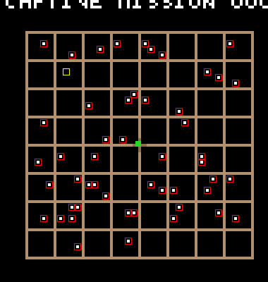
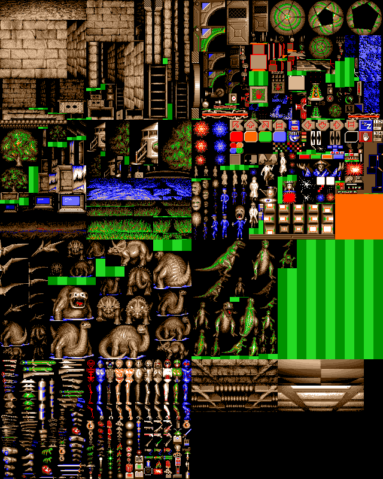
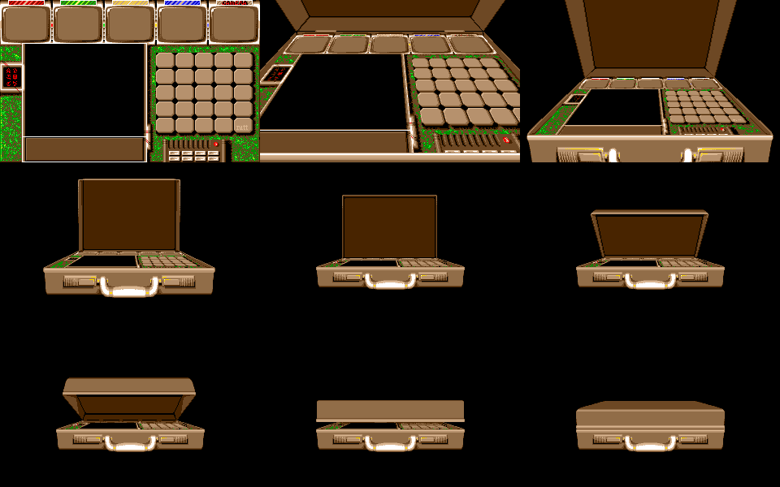

# Captive: the universe, the main loop, the 3D view and the picture files

Addresses are runtime addresses. The main program (`federation`) is at `$369a`, with globals relative
to A6 = `$1b5ce`. `fed_MapView` sits at `$2f3f0` while the map screen is up (`mission1.snap`). Every
claim carries a label: **proven** names the command and its count (the scripts are in `py/world/`,
whose README gives each command and its expected output), and **inferred** means read from the code
without an emulator check.

## 1. The universe is generated from the mission number

Each mission's map comes from one 16-bit linear congruential generator, seeded with the mission
index `14776(A6)`. The index is 0 for "CAPTIVE MISSION 0001" (`$30642` prints it plus one). Nothing in
the galaxy is stored on disk.

**The RNG** (`$3049c`, fed_MapView): `D0 = (D0.w * $5e5 + $29) mod 2^16`, and the output is
`D1 = ror.w #2` of the new D0. The multiplier 1509 is 1 mod 4 and the increment is odd, so the
period is the full 65,536. Some steps use D1 and some use D0 directly. The same constants are used
by `fed_MapGen`'s base path and by the creature AI (state at `15530(A6)` and `1770(A6)`), according to
the base and AI analyses.

**What the generator builds.** `mv_InitMission` (`$30280`) resets the ship state and runs these
steps in order, passing the RNG state in D0 from one step to the next (`$302ca`-`$302e4`):

| step | routine | output | rule |
|---|---|---|---|
| map dots | `$30430` | `13566(A6)` = `$1eacc`: 51 longs (x.w, y.w) | two RNG steps are discarded, and `$3043a` clears 301 longs from `13566(A6)`: the dot, moon and object tables (51 + 100 + 150) together. Each dot then takes x = D1 & 31 and y = (D1 >> 5) & 31; a draw with either field 0 is rejected (`beq $30446`). Each field is mapped through the 32-byte table `$3047c` = {0,1,2,3,5,6,7,8,10,...,38}, and a duplicate dot is rejected. |
| moons | `$303f6` | `13770(A6)` = `$1eb98`: 100 longs | parent planet = dot 1 + (D1 × 50 >> 16), orbit slot = D1 & 7 (byte 2). A duplicate (planet, slot) pair is rejected. |
| map units | `$3037a`, `$3039e` | in place | `c × 512 − $2600`; a moon adds its slot's offset from `$303d6`: the 8 compass points at ±160 units |
| targets | `$302fa` | byte 3 of `14170(A6)` = `$1ed28` (150 longs) | numbers 1..10 go to random free objects (D0 × 150 >> 16); an object already holding a number is redrawn (`tst.l` at `$3031c`, which relies on the clear at `$3043a`). Mission 0 forces object 0 first. |
| object bytes 0, 1 | `$3032c` | bytes 0, 1 of the 150 objects | objects 0..49 get (D0 & 31, D0 >> 5 & 31); objects 50..149 get ((D0 & 15) + 7, (D0 >> 5 & 15) + 7). They are the landing site on the body: (b − 15) map units from its centre, doubled for a planet (`$2fffc`; "Targets and landing seeds" below). This step reads the raw D0, not the rotated D1, so the sites inherit the LCG's short low-bit periods (below). |

**The coordinate table and the grid.** The map screen draws a dot for cell c at pixel `(66,73) + 2 × c`
and a grid line every 5 cells, at cells −1, 4, 9, ..., 39 (pixel x 64..144 and y 71..151, measured on the
rendered `mission1.snap`). The table `$3047c` skips every value that is 4 mod 5, so a dot never lies on a
line: each of the 8 grid squares on an axis holds 4 positions, and 8 × 4 = 32 entries fill the 5-bit field
exactly. Because a field of 0 is rejected, entry 0 is never used: 31 of the 32 values are reachable, and
the first row and column of the first square stay empty. Proven for the line positions and the dots:
0 of the 306 dot coordinates of missions 1, 2 and 8 are 4 mod 5 (`py/infographics/gen_universe.py`).

**Draws per step.** The step counts of each mission follow from the rejections. For mission 1 (index 0):
2 discards, 55 dot draws (3 with a zero field, 1 duplicate), 107 moon draws (7 duplicates), 9 target draws
(object 0 forced, no redraw) and 150 site draws, 323 in all, leaving D0 = `$0057`. Mission 2 takes 328
draws (55 dot, 111 moon, 10 target) and ends at `$c159`; mission 8 takes 331 (56, 113, 10) and ends at `$079a`. **Proven:**
`py/infographics/gen_universe.py` counts the draws in a second copy of the chain and asserts that its tables
equal `universe.py` and RAM and that its final D0 equals D0 at the return of each `callcap 302c6` re-run.

**Short periods in the raw state.** With a power-of-two modulus, bit k of D0 repeats with period 2^(k+1)
(bits 0..4: 2, 4, 8, 16, 32). The dots and moons use the rotated D1 and avoid this; the site bytes use D0.
On the mission 1 table the low nibble of site byte 0 repeats every 16 objects (134/134), its low bit
alternates (149/149), and a planet's byte 0 repeats every 32 objects (18/18). Proven on RAM
(`gen_universe.py`); whether the repetition shows in play is not checked.

**Proven.** `py/world/universe.py` reimplements every step and compares the result with RAM.

- On `mission1.snap` the station and planets match 51/51, the moons 100/100 and the objects 150/150.
- For missions 2 and 8 (indices 1 and 7), the mission word was poked (`w 1ef86 00010001` or `00070001`) and the generator re-run (`callcap 302c6`). The script's output matches the resulting RAM on all three tables: 51/51, 100/100 and 150/150 for each mission.
- Re-running the generator for index 0 changes only 6 bytes, so it reproduces the existing tables.
- On screen, `py/world/starscreen.py` finds 50 white pixels inside the grid of the rendered `mission1.snap`. The 50 generated planets land on exactly those pixels under `pixel = (66,73) + 2 × cell`, and no white pixel is left unexplained. The one generated dot not drawn as a pixel is slot 0, the station. (`world_map_fit.png`: red boxes are generated planets on white pixels, the yellow box is the station's cell.)

`infographic_universe.png` (`py/infographics/gen_universe.py`) draws the whole chain: the LCG and its bit
periods, the steps with mission 1's draw counts, the fit to the screen, the coordinate table against the
grid, a name worked through, and the maps of missions 1, 2 and 8.

**Names for the bodies, from the game's own text.** `$2ff6e` labels the selected object by its number
D6 (stored in `14782(A6)`). Numbers 1..50 print `PLANET-`, 51..150 print `MOON-` and 0 prints
`SPACE-STATION` (strings at `$30209`, `$30213` and nearby). So:

- the 51 dots are slot 0, the space station, followed by planets 1..50;
- the 100 orbiting bodies are moons;
- object index = number − 1: indices 0..49 are planets, 50..149 are moons.

Moons only ever orbit planets 1..50, never the station. Proven for the labels from the strings and
the branch; the station's own drawing path (`$2f7e2`, D3 = `$96`) is inferred.

**Body names** come from `$3066e`. It seeds with `mission × 150 + object index`, applies three LCG
steps with a byte swap after the first, and then uses four 4-bit fields to pick one syllable each
from four 16-entry tables (`$30706`, `$30726`, `$30746`, `$30766`, 1 or 2 letters per entry). A
seed argument of 150 gives `STATION`. The names are recomputed from that seed whenever a body is
labelled (inferred from the code); they do not come from the generator chain above, which only shares the LCG
constants. **Proven for one name:** `star.snap` has object 14 selected
(`14782(A6)` = `$e`), and the screen reads `PLANET-PAICKOT`. `universe.py --names`
gives index 13 = PAICKOT. The other names are inferred.

**Targets and landing seeds** (`$2ff62`-`$2ffe6`, `$2f5f4`-`$2f69c`, `$87d6`-`$8814`). Map slot 0 is the station
and slots 1..150 are the bodies; body slot s owns object record s − 1, so universe.py's "object 0" (target 1 at
mission 1) is planet slot 1, PLANET-BUTRE. Target 9 of mission 1 is object 107, PHUPET, one of BUTRE's own moons
(moon table entry 57), so two targets share one planet on the map (computed from the model, which equals RAM).

- **Selecting a site.** A click on the map moves the cursor (`$2feb0`, one pixel = 2^zoom units, zoom `14770(A6)`
  from 8 down to 0 with the two ladder icons, `$2f70a` in and `$2f72e` out) and clears the selection words
  `14782`-`14786(A6)` to −1. `$30042` snaps the cursor to a body slot, which goes to `14782(A6)`. For a body,
  `$2fffc` then tests the cursor against the site: object bytes 0, 1 give an offset of (b − 15) units from the
  body's centre, doubled for a planet (slot 50 or below), and the cursor must lie within 4 units of it on both
  axes. On a hit, `14786(A6)` = 0 and `14784(A6)` = the object's target number (byte 3), or stays −1 for a body
  with no target. At zoom 2 the site is drawn as a dot inside the body's circle.
- **Landing.** LAND (`$2f542`, in orbit only, ship state `14858(A6)` = 6) copies the selection to
  `14816`/`14818(A6)` and starts the landing sequence (`14820(A6)` = 1). When that sequence reaches 2 (`$2f4d4`),
  `$2f5f4` writes the request word `14788(A6)`, which `$8852` turns into the map
  mode `13564(A6)`: no site selected gives request 3 (mode 0, the uniform landing surface, D1 = `$ffff`); a site
  with no target gives request 3 with a body seed; a target gives request 1 (mode 1), or 2 when the object's
  byte 2 bit 1 is set (mode 2).
- **Revealed targets.** A target number k is shown on the map only if bit k−1 of the mask `14796(A6)` is set. The
  mask starts at 1 (`$30280`). Landing does not test the mask.
- **Visited targets.** `$87d6`, which ends a base (`ai.md`), takes the slot landed on, `14782(A6)`; when its object
  holds a target number (byte 3) it sets bit 1 of byte 2 and adds 1 to `14794(A6)` (`$87de`-`$87f4`). The add does
  not test the bit, so `14794` counts exits from target bases, not distinct targets. The map prints it as a digit
  while it is 1..9 (`$304f2`); it is cleared at a new mission (`$302c6`) and when the final base is won (`$8810`).
  **Proven**: `py/ai/level_event.py` on `base1/in.snap` (labelled pokes `14798(A6)` = 1, `15608(A6)` = `$ffff`):
  `$87d6` once, `14794(A6)` 0 to 1, mode 3 to 1; `py/phoopel/revisit.py exit` (a generator-blown base left by the
  entrance click): `$87ee` and `$87f4` once each, target 1's entry `0a040001` to `0a040201`, `14794` 0 to 1.
- **A target is finished once.** A base is entered only from mode 1 (`ai.md`, "Getting into a base"), and mode 1
  comes only from request 1, a landing on a target whose bit 1 is clear. Landing on a visited target gives request 2,
  mode 2, a surface built with D2 = 6 from the same body seed, where standing on the entrance does nothing. After an
  exit `13410(A6)` = 4 bars re-entry from the compound (`$bd72`) until the next landing clears it (`$885a`), read. **Proven**
  (`revisit.py land`, from `base1/site.snap`, ORBIT and LAND clicked as in `natural_base.repl`, then the party poked
  onto the entrance `13556(A6)`): control, D2 = 2, mode 1, `$bd84` 1 and the base generated (`$b5c2` 1), mode 3; with
  only target 1's bit 1 poked, D2 = 6, mode 2, `$bd6a` 31 tests and `$bd84` 0, mode stays 2.
- **Final target.** The station (slot 0) has no site. Landing there with `14794(A6)` above 9 writes request 4
  (`$2f676`) with base seed `mission × 11 + 10`; since `14782(A6)` = 0, `$b5a0` builds it with D2 = 1. With 9 or less
  it branches to `$2f4f0` and writes no request (`$2f66e`-`$2f674`, read). The generator gives each mission ten targets
  on ten distinct objects (`$302fa`, the table above), and each can be finished once, so reaching the final base
  needs every target finished. **Proven** (`py/world/station/station.py`, from `mission1.snap`: the station selected
  by a click on the map, `14782` = 0, then ORBIT and LAND; a labelled poke of `14794(A6)` after the selection is the
  only difference between arms, 25M steps each): with 10, `$2f676` once, `14788` written 4 there and cleared by
  `$885e`, `32(A6)` = 10, and `fed_MapGen` entered at `$b5c2` with D0 = 10, D2 = 1; with 9 and with 0, `$2f66e` and
  `$2f4f0` once, `$2f676` and `$b5c2` 0, nothing written to `14788`, and the ship stays in orbit ("DOCKING COMPLETE").
  The final base has no compound: request 4 goes straight to mode 3, and the party is placed at (53,0), facing 2 (S), while
  the modules load ("LOADING ..." for about 12M steps after LAND; 310 FDC reads, all completed, against 280 for a
  target landing). The base view is up by 13M steps. Left without input, the party dies there: the group beside it
  at (54,0) (`$1d33a`, type `$1d`, aware and hostile) attacks (`$10e4a`, then `$f884` and droid damage `$9a9a`), the
  live-droid count `410(A6)` falls 4, 3, 1, 0 between 14.6M and 15.35M, and `$876a` sets `14800` = 1, "DROID'S HAVE
  FAILED!" (`py/world/station/death.py`, `fdc.py`). A target landing left the same way loses no droid in 60M steps,
  but it puts the party in a compound, not beside a guard. Whether a party that moves off (53,0) survives, and why a
  group stands beside the entrance, are not tested.
- **Seeds passed to `fed_MapGen`.** A target landing stores a base seed `32(A6) = mission × 11 + (k − 1)` and a body
  seed `14790(A6) = (mission & $1ff) × 150 + (slot − 1)`. These become MapGen's D0 and D1 (README, "The base
  generator").

**Proven** by `py/ai/natural_base.repl` from `mission1.snap` (no poke): planet slot 1 selected at zoom 2 with the
cursor at (`$208`, `$1214`) gives `14784(A6)` = 1, `14786(A6)` = 0. ORBIT, then LAND writes request 1 at `$2f61a`
(stserver watch on `$1ef92`: that write, then the clear at `$885e`), and the generator is called with D0 = 0,
D1 = 0, D2 = 2. The base itself is entered from that level (`ai.md`, "Getting into a base").

## 2. Main loop and interrupts

- **Main loop** (`main_Loop`, `$5666`-`$56c2`): a fixed list of `bsr` calls, among them `$b136`, `$8710`, `$9b9a` (which ends in the view render), `$572c`, `$bcfc`, `$b17c`, `$598a`, `$9532` and `$6914`-`$6e36`, then `bra $5666`. **Proven:** in the census of 1.2M steps (100 VBLs) on the planet surface from `ld_1.snap`, each of these runs 20 times (`$9532` 19), so the main loop runs once per 5 VBLs there. Its length follows the load: inside the natural base it takes 68,793 to 87,207 steps, median 72,000 (6 VBLs), over 100 frames (`ai.md` "Scheduling", `py/ai/sched.py`). The rest of the frame goes to interrupt work.
- **VBL** (`$435a`, 100 calls per 100 VBLs): it increments a frame counter at `$b17a`, resets the raster-list index `$45da`, re-arms MFP Timer B (`$fffa21` = 3, Timer B control and enable) and calls `$4e8c` for the per-VBL work. Proven as a count; the role of `$4e8c` is not read.
- **Timer B raster list** (`$4398`, 300 calls per 100 VBLs): the handler is self-modifying. Its first instruction is `move.w #imm,$ffff8xxx`, and each interrupt rewrites that immediate and that address from the next 6-byte entry of a list at `$45ec`. Each entry gives a value, a register offset from `$ff8000`, and the line count to the next interrupt. An entry with no register and value 1 copies a full 16-colour palette from `$471e` (`$4418`) and increments the word pair at `$45e6`. This is a small copper list for the ST, used here to split the palette between the top and bottom of the screen. Inferred; the list at `ld_1` and `mission1` is `{0003 0000 0260}`, `{00be 0000 ffff}`.
- **A second RNG.** `$460a` keeps a 32-bit state at `$462c` that advances by `$1d1d1d1d` plus the word at `$45e6`, and returns one byte of the state chosen by state bits 2-3. Inferred from its body. A raw scan for direct `bsr`/`jsr` targets in `ld_1`, `mission1` and `mg_entry` finds no caller, and it did not run in 1.2M surface steps (`hits`), so its user is not known.

## 3. The first-person view

The view is a grid dungeon view in the style of Dungeon Master. A fixed cone of cells in front of
the party is drawn back to front from pre-drawn pieces. Nothing is scaled or ray-cast. The renderer
**pairs every wall, floor and ceiling piece with a mirror image and alternates the two with the
party's step and turn counters**, so a move changes the picture even though the art is static.

**The map.** The map is 64 × 32 bytes at `9242(A6)`, one byte per cell; `map_CellAt` (`$adb6`) reads
index `y × 64 + x`, and coordinates outside the map read 0. The party's position and facing are
`26(A6)`, `28(A6)` and `30(A6)`. `view_RotateByFacing` (`$adde`) turns a view-relative (dx, dy) into
a map offset by facing & 3. `view_CellAtRelative` (`$ad90`) adds that offset to the position and
stores the cell at `68(A6)`/`69(A6)`. Inferred.

**The view cone** (`view_Render`, `$9d86`):

1. It draws the floor, piece `46(A6) & 1`. It then draws the ceiling, piece `2 + ((counter + 1) & 1)`. The counter is `30(A6)` (facing) outdoors and `46(A6)` in mode 3, inferred to be a base.
2. It walks 38 view slots from the table `$83be` (D7 = 0..`$130`, step 8), calling `view_DrawSlot` (`$a1c4`) for each.

Each 8-byte slot holds dx.w, dy.w, a piece number, a kind, and an index into a local copy of the
surrounding cells at `15382(A6)`. The slots cover dx −2..2 and dy −4..0 and are ordered by depth,
farthest row first, outer columns before inner. Kind 2 is a cell's front face, kinds 1 and 3 its
left and right faces, and kinds with bit 3 set (`$8`-`$d`) are the cell contents. `$a1c4` reads the
cell's code and dispatches on it to the wall, door, object and party handlers (`$a1fc`-`$a302`). What
each generator feature tile is when seen and entered (hand-operated door, valve, floor trap, spinner,
false wall, decorated rock face) is in `mapgen.md`, "After the flow field".
`$a848` draws the other droids standing in a visible cell from the four (x, y, facing) entries at
`176(A6)`. **Proven** as counts: on the surface `$9d86` runs 20 times and `$a1c4` 752 times in 1.2M
steps (20 × 38 = 760; why the count is 8 short is not checked). The cone and dispatch are
inferred from the code.

**Mirror parity.** A wall face is drawn as piece `n + (46(A6) & 1)` on one side and
`n + ((46(A6) + 1) & 1)` on the other (`$ad26`, `$ad50`). Front faces use `48(A6) & 1` (`$ad6e`). A
step increments `46(A6)` (`$931c`), and a turn adds `$10001` to the longword at `46(A6)`, stepping both
`46` and `48` (`$909c`). In the piece table, every odd piece repeats the even piece before it with the
mirror flag set. Inferred: the party does not move in any snapshot so far.

**The piece table and blitter.** `gfx_DrawPiece` (`$b230`) takes piece N and reads the 8-byte entry
N at `15922(A6)` (= `$142ae`):

| bytes | field |
|---|---|
| 0-1 | source offset in the sheet |
| 2-3 | destination offset in the view buffer; `$ffff` means not drawn |
| 4 | width in bytes |
| 5 | height in rows |
| 6 | flags; `54(A6)` is XORed into them |
| 7 | sheet: a byte offset into the sheet pointer array at `15770(A6)` |

The flags select the copy routine:

| flag | meaning | routine |
|---|---|---|
| bit 0 | mirror: the source is read right to left through a bit-reverse table at `15766(A6)` (= `$572e0`) | `blit_Mirror` `$4bd4` |
| bit 2 | masked: colour 0 is transparent (mask = NOT of the OR of the four planes) | `$4978` (words), `$4a06` (bytes) |
| bit 2 clear | opaque copy | `$4948` (words), `$49d6` (bytes) |
| bit 1 | word width rather than byte width | |
| bit 3 | vertical options: a bottom-up copy (row step −40, `$b31a`) or, with bit 4 and bits 5-7, a partial height of ¼, ½ or ¾ (`$b2a6`) | |

Door code sets `54(A6)` to `$18`, `$38` or `$58` (`$a996`-`$a9b2`) to draw a door part-open.

The evidence for this table:

- the bit-reverse table is checked: 256 of 256 entries are bit-reversed (proven);
- **proven** counts on the surface over 1.2M steps: `$b230` 298 calls, `$4948` 20, `$4978` 1,033 (it has other callers), `$4a06` 238, `$4bd4` 137 and `$49d6` 0 (`hits` on `ld_1.snap`);
- the field meanings are inferred from the code.

**The view buffer** is at `15754(A6)` (= `$f51e0`). It is Amiga-style planar: four separate planes of
2,240 bytes, each 20 bytes by 112 rows, of which 144 pixels (18 bytes) are drawn. Proven by
`py/world/render_pics.py`, whose decode of the buffer (`view.png`) is the view on the `ld_1` screen.
A later step copies the buffer to the interleaved ST screen; that step is not read. The landing
surface is uniform (README, "The base generator"), so the `ld_1` view is only floor, sky and a
horizon strip.

## 4. Picture sheets

**Format.** Each `fedN*.pic` file (and the `FedAnni*.pi` files) is 32,000 bytes: four separate
8,000-byte bitplanes, 40 bytes per row, 320 × 200. This is the Amiga layout, not the ST's interleaved
words. Proven: the blitters read planes at +8000, +16000 and +24000 with a 40-byte row step (`$b36a`,
`$4950`), and every file renders cleanly through `render_pics.py`. The boot code converts Amiga
12-bit palette words for the ST with `lsr #1` / `and #$777` (`$132e` in `fed_BootFile`; inferred).

**The sheets loaded on the planet surface.** `tools/find_files_in_ram.py` on `ld_1.snap` matches all
seven buffers named by `15770(A6)` in full, 32,000/32,000 bytes each (proven):

| sheet byte | buffer | file | contents (from the render) |
|---|---|---|---|
| 0 | `$1f7b0` | fed7-E | stone walls drawn at each depth and side |
| 4 | `$275c0` | fed2-A | doors, machinery, panels |
| 8 | `$2f3d0` | fed3-B | trees, computers, ground and sky strips |
| 12 | `$371e0` | fed5 | control-panel icons |
| 16 | `$3eff0` | fed6-E | creatures, pre-drawn at several sizes |
| 20 | `$46e00` | fed8 | items |
| 24 | `$4ec10` | fed6-F | creatures |

The piece table uses only sheets 0, 4 and 8: 112, 117 and 142 of its first 400 entries, with 29
entries having sheet 255. The floor and ceiling pieces (2 and 3) come from sheet 8 at row 156, 44
rows high. The creature and item sheets are drawn by other routines that are not read yet.
`world_sheets_surface.png` shows fed7-E, fed2-A, fed3-B, fed5, fed6-E, fed6-F, fed8 and fed9, two per
row. `world_fed7E_walls.png` is the wall sheet alone.

**Which variant loads.** `env_LoadSheets` (`$b5f0`) writes the variant letter into a filename table
in `federation` (`$4630`: `FED1:`, then `1fed7-E.pic`, `1fed2-A.pic`, ...), then loads each file
through `file_LoadPic` (`$b736`). Inferred from the code, except where marked:

- **fed7** (sheet 0, the walls): `E` outside a base (mode `13564(A6)` ≠ 3). In a base the letter is `D` when `13412(A6)` is set, and otherwise `A + ((32(A6) & $3f) mod 3)`. Before loading a base's fed7, the loader reads `fed9.pic` and copies one of its three 44-row ceiling strips (column offset from `$b69a`) into sheet 8 at row 156. So bases come in three wall-and-ceiling styles chosen by the base seed.
- **fed3** (sheet 8): `A` in mode 3, `B` otherwise (`$b6a2`).
- **fed2** (sheet 4): `A` plus bit 2 of `33(A6)`, the low byte of the base seed (`$b6c2`).
- **fed6** (creatures): `$b6de` walks the 7 low bits of `13402(A6)`, which is the D0 that `fed_MapGen` returns. For each set bit i it loads `fed6-<A+i>` into the next free buffer and records the buffer per letter in `15798(A6)`. So the base generator decides which creature sheets a level loads. **Proven** for the landing: MapGen returned 48 (bits 4 and 5), and RAM holds fed6-E and fed6-F.
- **fed5** and **fed8** are fixed (`$b71a`).

`fed_MapGen` itself is loaded into the first of these buffers (`15770(A6)` = `$1f7b0`, README) and
is overwritten when fed7 loads after it returns (`$b67c`).

## 5. Case.pic: the briefcase opening

`Case.pic` is a 388-byte animation player followed by nine full-screen frames: 388 + 9 × 32,000 =
288,388 bytes, the code hunk's exact length. Proven by `py/world/case_frames.py`, which decodes the
frames shown in `world_case_strip.png`.

**The player.** Its code is at `$0`-`$bd` of the hunk:

1. It saves the screen pointer passed in A1 and points the VBL vector `$70` at a handler (`$b2`) that sets a flag.
2. It clears the palette, shows frame 8, waits one VBL and loads the palette at `$c8` (the game's own 16 colours).
3. It then steps through the frame list at `$e8`, holding each frame for 7 VBLs, until it reaches an entry of −1.

The list is frame 8 eight times, then 7, 6, 5, 4, 4, 4, 4, 5, 6, 7, then 8 eleven times, then 7
down to 0. The frames show:

- 8: a closed briefcase;
- 7 down to 4: the lid opening, closing again, and then opening;
- 3 down to 1: the camera moving into the open case;
- 0: the control panel itself, which is close to `fed4.pic` (26,341 of 32,000 bytes equal).

**Who runs it.** `fed_BootFile` does, between the intro and the game:

1. it shows `FED_Credits` (`$12da`);
2. it runs `Fed_Demo` (`$1346`);
3. it loops: load `Case.pic` and `jsr 32(A3)` (`$13aa`), load `Federation` and `jsr 32(A3)` (`$13ee`), and return to `$139e`.

The addresses are inferred from the code. The protection analysis observed the load from a cold
boot: Case.pic is loaded at step 214,274,718 and freed at 221,076,017.

**The README's 132,973-byte match.** Case.pic's hunk is aligned at `$1f62c`, so frame 0 starts at
`$1f62c + $184` = `$1f7b0`. That is the first picture buffer, which holds `fed4.pic` at mission 1. Most
of the match is therefore fed4 sitting where Case.pic's frame 0 would be, not a live copy of Case.pic.

## Routine names

| address | name | evidence |
|---|---|---|
| `$3049c` | `mv_Rng16` | body; proven by `universe.py` |
| `$30280` | `mv_InitMission` | body |
| `$30430`, `$303f6` | `mv_GenPlanets`, `mv_GenMoons` | proven by `universe.py` |
| `$3037a`, `$3039e` | `mv_PlanetsToMapUnits`, `mv_MoonsToMapUnits` | proven by `universe.py` |
| `$302fa`, `$3032c` | `mv_MarkTargets`, `mv_GenObjectParams` | proven by `universe.py` |
| `$3066e`, `$30664` | `mv_ObjectName`, `mv_PlanetNameFromDrawIndex` | body; one name checked on screen |
| `$5666` | `main_Loop` | body, census |
| `$435a`, `$4398` | `irq_VblRasterReset`, `irq_TimerBRasterList` | body |
| `$460a` | `rng_StateByte` | body |
| `$9d86`, `$a1c4` | `view_Render`, `view_DrawSlot` | body |
| `$adde`, `$ad90`, `$adb6` | `view_RotateByFacing`, `view_CellAtRelative`, `map_CellAt` | body |
| `$a848` | `view_DrawDroidsInCell` | body |
| `$b230` | `gfx_DrawPiece` | body |
| `$4948`, `$4978`, `$49d6`, `$4a06`, `$4bd4` | `blit_CopyWords`, `blit_MaskWords`, `blit_CopyBytes`, `blit_MaskBytes`, `blit_Mirror` | body |
| `$b5f0`, `$b6a2`, `$b6c2`, `$b6de`, `$b736` | `env_LoadSheets`, `env_LoadFed3`, `env_LoadFed2`, `env_LoadCreatureSheets`, `file_LoadPic` | body |
| `$13aa` (fed_BootFile) | `boot_RunCase` | body |

## Open questions

- How the station is drawn at the full-map zoom.
- Who calls `$460a`.
- How the view buffer is copied to the screen.
- The mirror alternation and a base-interior view have not been seen on screen. Both need a drive that moves the party one step, and one inside a base.
